# Predicting Early Recurrence in Colorectal Cancer (CRC) Using Gene Expression Profiles
### An M.Tech Bioinformatics & Machine Learning Research Project

[](https://www.python.org/)
[](#)
[-orange.svg)](#)
[-green.svg)](https://www.ncbi.nlm.nih.gov/geo/query/acc.cgi?acc=GSE39582)
[-purple.svg)](https://www.ncbi.nlm.nih.gov/geo/query/acc.cgi?acc=GSE14333)
[-red.svg)](https://www.ncbi.nlm.nih.gov/geo/query/acc.cgi?acc=GSE50760)
[-blue.svg)](https://portal.gdc.cancer.gov/)
[-gold.svg)](#-phase-3-combined-multi-center-gpl570-mega-cohort-leave-one-cohort-out)

---

📄 **Research paper:** [paper/CRC_early_recurrence_paper.pdf](paper/CRC_early_recurrence_paper.pdf) (HTML source and figure script in [`paper/`](paper/)).

## ⚠️ Revised Results (audit of 14 November 2026)

An audit of the pipeline found problems that changed the reported numbers. Everything in this README has been regenerated from the corrected code; the previous code, results and documents are kept in `archive/pre_audit_2026-11-14/`.

**What was fixed**
1. **Normal tissue in the training cohort.** 15 of the 264 GSE39582 "patients" were non-tumoral mucosa samples (`dataset = "Non Tumoral"`), each paired with a tumour from the same patient. They are now excluded; the discovery cohort is **249 tumours (56 early recurrence, 193 disease-free)**.
2. **No clinical baseline.** Every result is now compared with **TNM stage alone** (no model), with bootstrap 95% CIs and a paired DeLong test. "Genes + stage" variants of each model were added.
3. **Hand-set hyperparameters.** Replaced by **repeated nested cross-validation** (5 repeats × 5 outer folds, 3-fold inner GridSearchCV over classifier settings and gene count). The decision threshold is also chosen inside each training fold.
4. **Batch shift in external validation.** GSE14333 is now gene-wise location/scale-matched to the training cohort using its own unlabelled Stage I–III samples. Without this, three of four frozen models predicted every external patient as low-risk.
5. **Survival validation on the full external cohort.** Kaplan–Meier/Cox analysis now uses all 226 Stage I–III GSE14333 patients, not only the 64 extreme-outcome patients.
6. **Mega-cohort and TCGA endpoints.** Both now use the same ≤12 mo vs ≥60 mo endpoint (they previously used "any recurrence/progression" with censored patients as disease-free). The mega-cohort uses per-cohort standardisation, leave-one-cohort-out validation and inner tuning.
7. **Metastasis analysis.** The GSE50760 liver metastases contain normal liver tissue; the paired analysis is now liver-adjusted. A code path that **wrote invented pathway results when the Enrichr service was unreachable** has been removed.
8. **Documentation.** The previous README external-validation table did not match the pipeline output (e.g. Linear SVM sensitivity 0.333 reported vs 0.067 produced).

**Headline results**

| Setting | Stage alone | Gene-only models | Gene model beats stage? |
| :--- | :---: | :---: | :---: |
| GSE39582, repeated nested CV (n = 249) | **0.626** (0.557–0.697) | 0.51–0.54 | No; stage is better (DeLong p = 0.02–0.09) |
| GSE14333 external, binary (n = 64) | **0.773** (0.675–0.855) | 0.70–0.75 | No (p ≥ 0.44) |
| Mega-cohort, pooled leave-one-cohort-out (n = 356) | **0.680** (0.626–0.733) | 0.62–0.66 | No (p ≥ 0.22) |
| TCGA-COADREAD, curated endpoint (n = 57) | 0.635 | 0.40–0.43 | No (too few patients) |

ROC-AUC with bootstrap 95% CI. **No gene-expression model discriminates early recurrence better than stage alone.**

**The positive finding is prognostic value beyond stage, replicated in two independent cohorts.** The frozen classifiers' risk scores predict disease-free survival after adjusting for stage in all 226 Stage I–III GSE14333 patients (Cox HR per SD 1.35–1.48, p = 0.001–0.008, all 8 models) and in all 135 Stage I–III GSE17536 patients (HR 1.30–1.63; p < 0.05 for 6 of 8 models; Linear SVM HR 1.59, p = 0.002). A dedicated survival model (XGBoost-Cox on all 485 GSE39582 Stage I–III tumours, section 5.7) added to stage internally and in GSE14333 but **did not replicate in GSE17536**.

---

## 🧭 Table of Contents
1. [Project Overview & Motivation](#-project-overview--motivation)
2. [Research Phasing & Multi-Cohort Hierarchy](#-research-phasing--multi-cohort-hierarchy)
3. [The Human Story: Technical & Biological Challenges We Faced](#-the-human-story-technical--biological-challenges-we-faced)
4. [System Architecture & Research Pipeline](#-system-architecture--research-pipeline)
5. [Phase 1: Microarray Discovery & External Validation](#-phase-1-microarray-discovery--external-validation)
   - 5.1 [Cohort Curation & The Clinical Recurrence Endpoint (GSE39582)](#51-cohort-curation--the-clinical-recurrence-endpoint-gse39582)
   - 5.2 [Biomarker Discovery & Differential Expression](#52-biomarker-discovery--differential-expression)
   - 5.3 [Phase 1 ML Benchmark & Strict Anti-Leakage Protocol](#53-phase-1-ml-benchmark--strict-anti-leakage-protocol)
   - 5.4 [Model Explainability with SHAP](#54-model-explainability-with-shap)
   - 5.5 [Blinded Independent External Validation (GSE14333)](#55-blinded-independent-external-validation-gse14333)
   - 5.6 [Paired Colorectal Liver Metastasis Analysis (GSE50760)](#56-paired-colorectal-liver-metastasis-analysis-gse50760)
   - 5.7 [Survival Modelling (XGBoost-Cox) and Two-Cohort Survival Validation](#57-survival-modelling-xgboost-cox-and-two-cohort-survival-validation)
6. [Phase 2: Large-Scale High-Throughput RNA-seq Cohort (TCGA-COADREAD)](#-phase-2-large-scale-high-throughput-rna-seq-cohort-tcga-coadread)
   - 6.1 [Motivation & Large Cohort Characteristics](#61-motivation--large-cohort-characteristics)
   - 6.2 [Progression-Free Interval (PFI) Endpoint Definition](#62-progression-free-interval-pfi-endpoint-definition)
   - 6.3 [Phase 2 ML Model Training & Stratified 5-Fold CV Accuracy](#63-phase-2-ml-model-training--stratified-5-fold-cv-accuracy)
   - 6.4 [Phase 2 ROC, Precision-Recall & Confusion Matrix Analysis](#64-phase-2-roc-precision-recall--confusion-matrix-analysis)
   - 6.5 [Cross-Platform Biological Concordance (Microarrays vs. RNA-seq)](#65-cross-platform-biological-concordance-microarrays-vs-rna-seq)
7. [Phase 3: Combined Multi-Center GPL570 Mega-Cohort (Leave-One-Cohort-Out)](#-phase-3-combined-multi-center-gpl570-mega-cohort-leave-one-cohort-out)
   - 7.1 [Multi-Center Dataset Aggregation (GSE39582 + GSE14333 + GSE17536 + GSE17537)](#71-multi-center-dataset-aggregation)
   - 7.2 [Per-Cohort Standardisation](#72-per-cohort-standardisation)
   - 7.3 [Phase 3 Leave-One-Cohort-Out Results](#73-phase-3-leave-one-cohort-out-results)
   - 7.4 [Phase 3 ROC, Precision-Recall & Confusion Matrix Analysis](#74-phase-3-roc-precision-recall--confusion-matrix-analysis)
   - 7.5 [Interpretation](#75-interpretation)
8. [Interactive Clinical Web Dashboard (`app.py`)](#-interactive-clinical-web-dashboard-apppy)
9. [Repository Structure & Quickstart Guide](#-repository-structure--quickstart-guide)
10. [Academic Disclaimer & Ethics](#-academic-disclaimer--ethics)

---

## 💡 Project Overview & Motivation

When a surgeon removes a colorectal tumor from a Stage I, II, or III patient, everyone hopes the disease is eradicated. But for roughly 20% to 30% of patients, occult micrometastases have already escaped into regional lymph nodes or mesenteric circulation. In the most aggressive cases, the cancer returns within **12 months**—often presenting as incurable metastases in the liver or peritoneum.

Current clinical management relies primarily on anatomical TNM staging. Yet **two patients with identical Stage II tumors frequently experience completely divergent outcomes**: one remains cancer-free for decades, while the other relapses within nine months. Standard histopathology cannot capture the underlying transcriptomic wiring that determines metastatic competence.

Our objective was to build a rigorous, leak-free machine learning system using **high-dimensional gene expression profiles** to:
1. Predict early disease recurrence ($\le 12$ months) in Stage I–III patients before macroscopic metastases emerge.
2. Screen for candidate transcriptomic biomarkers of early recurrence (none reach FDR < 0.10 in this cohort; see 5.2).
3. Validate predictive generalization on a completely blinded external hospital cohort (**GSE14333**, $n=64$).
4. Trace tumor evolution across matched patient triplets from normal colon to primary tumor and liver metastasis (**GSE50760**, $n=54$).
5. Test the approach on an RNA-sequencing cohort (**TCGA-COADREAD**; 306 Stage I–III patients, of whom only 57 meet the curated endpoint).

---

## 🧬 Research Phasing & Multi-Cohort Hierarchy

To avoid conflating distinct experimental modalities, patient cohorts, and sequencing technologies, the project is structured into two clearly demarcated research phases:

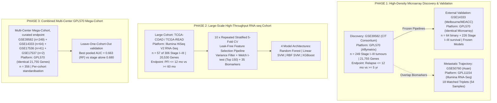

| Phase | Dataset | Technology / Platform | Stage Cohort ($n$) | Total Features | Primary Clinical Endpoint | Role in Project |
| :--- | :--- | :--- | :---: | :---: | :--- | :--- |
| **Phase 1** | **GSE39582** | Affymetrix HG-U133 Plus 2.0 | $n = 249$ | 21,755 genes | Relapse $\le 12$ mo ($n=56$) vs $\ge 5$ yr ($n=193$) | Primary Discovery & 5-Fold CV |
| **Phase 1** | **GSE14333** | Affymetrix HG-U133 Plus 2.0 | $n = 64$ (226 for survival) | 21,755 genes | Relapse $\le 12$ mo ($n=15$) vs $\ge 5$ yr ($n=49$); DFS for all Stage I–III | Blinded External Validation |
| **Phase 1** | **GSE50760** | Illumina HiSeq RNA-seq | $n = 54$ | 20,000+ genes | Paired Mucosa $\to$ Primary $\to$ Liver Met | Metastatic Trajectory Dynamics |
| **Phase 2** | **TCGA-COADREAD** | Illumina HiSeq V2 RNA-seq | $n = 57$ (of 306) | 20,530 genes | PFI $\le 12$ mo ($n=28$) vs event-free $\ge 60$ mo ($n=29$) | RNA-seq Check (underpowered) |
| **Phase 3** | **Combined Mega-Cohort** | Affymetrix HG-U133 Plus 2.0 | $n = 356$ | 21,755 genes | Relapse $\le 12$ mo ($n=78$) vs $\ge 5$ yr ($n=278$) | Leave-One-Cohort-Out Benchmark |

---

## 🛠️ The Human Story: Technical & Biological Challenges We Faced

Building this system involved addressing significant computational, methodological, and biological hurdles:

### 1. The High-Dimensional Curse ($p \gg N$) & The Data Leakage Trap
* **The Challenge:** With up to $21,755$ gene features and only several hundred patients, naive pipelines easily suffer from data leakage—producing artificially inflated accuracies ($>95\%$) that fail completely in clinical reality.
* **Our Solution:** We implemented fold-isolated feature engineering ([`BioinformaticsFeatureSelector`](file:///Users/divyanshusingh/CRC-ML-Model/src/feature_selection.py)). All variance thresholding, Welch's t-test ranking, and scaling transformations were fitted exclusively inside each training fold during Stratified 5-Fold Cross-Validation. The validation fold was never touched until evaluation.

### 2. Clinical Follow-up Ambiguity
* **The Challenge:** In retrospective cancer registries, patients with short follow-up (e.g., 18 months without recurrence) cannot be safely labeled as "cured," nor should indolent late relapses (e.g., recurrence at year 5) be conflated with hyper-aggressive early relapse.
* **Our Solution:** In Phase 1, we established a strict clinical gate: early recurrence ($\le 12$ months, $n=56$) versus long-term disease-free follow-up ($\ge 60$ months, $n=193$), excluding intermediate cases and the 19 non-tumoral mucosa samples in GSE39582. In Phase 2 the same rule is applied to the TCGA Pan-Cancer Clinical Data Resource (Liu et al., *Cell* 2018) Progression-Free Interval (PFI).

### 3. Affymetrix Probe Redundancy
* **The Challenge:** GPL570 arrays measure 54,675 probesets for ~20,000 unique human genes. Multi-mapping probes create redundant noise and multicollinearity.
* **Our Solution:** We implemented the standard Bioconductor **maximum-variance collapse protocol**, mapping each unique HGNC gene symbol to the single probeset with the highest dynamic range across the cohort in 0.25 seconds.

### 4. Memory Optimization on Apple Silicon (M4)
* **The Challenge:** Storing 54,675 probes across hundreds of samples in 64-bit float arrays consumes excess memory and triggered a dynamic linker bug in SciPy 1.15.
* **Our Solution:** We downcast all expression values to `float32` and saved feature matrices as Snappy-compressed **Apache Parquet files**, reducing memory footprints to just **125 MB RAM** and enabling sub-second I/O.

---

## 🏗️ System Architecture & Research Pipeline

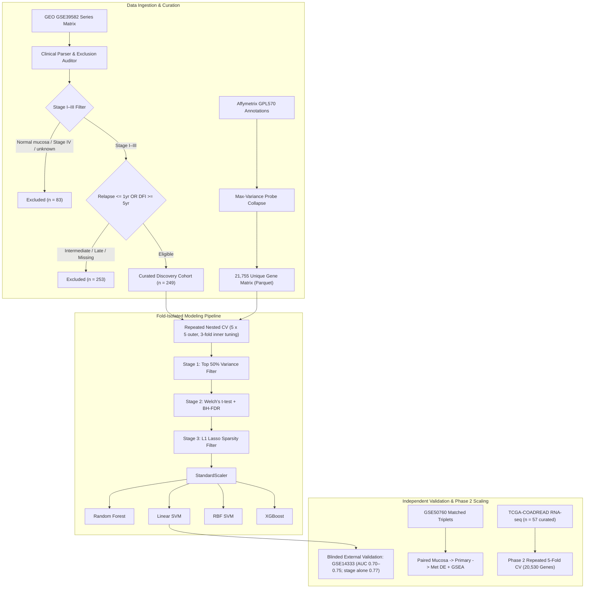

---

## 🔬 Phase 1: Microarray Discovery & External Validation

### 5.1 Cohort Curation & The Clinical Recurrence Endpoint (GSE39582)

Across all 585 samples in GSE39582, clinical auditing yielded a discovery cohort of **249 Stage I–III tumours** (the 19 non-tumoral mucosa samples in the series are excluded):

<p align="center">
  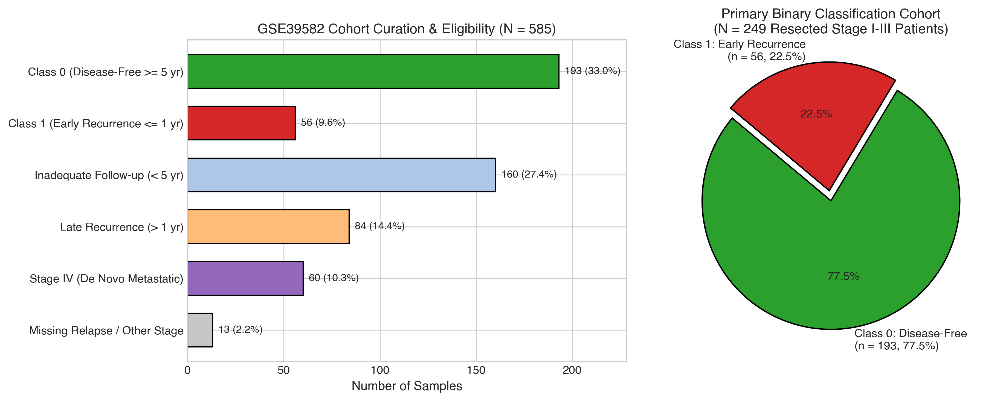
</p>

* **Figure 1 (Left):** Complete accounting of all 585 samples and explicit clinical exclusions.
* **Figure 1 (Right):** The primary machine learning cohort ($n = 249$):
  * **Class 1 (Early Recurrence $\le 12$ months):** 56 patients (**22.5%**)
  * **Class 0 (Long-Term Disease-Free $\ge 60$ months):** 193 patients (**77.5%**)
  * **Class Imbalance Ratio:** $3.45 : 1$ (handled via cost-sensitive weighting; `scale_pos_weight` is computed from the training data).

<p align="center">
  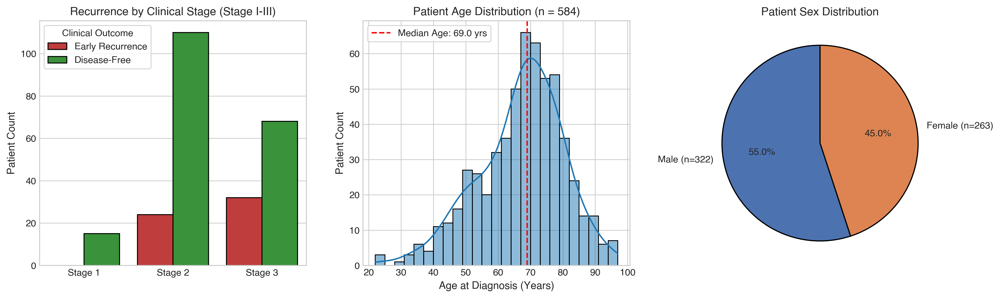
</p>

* **Figure 2:** Distribution of patient age, gender proportions, and recurrence frequencies stratified across Stage I, II, and III.

<p align="center">
  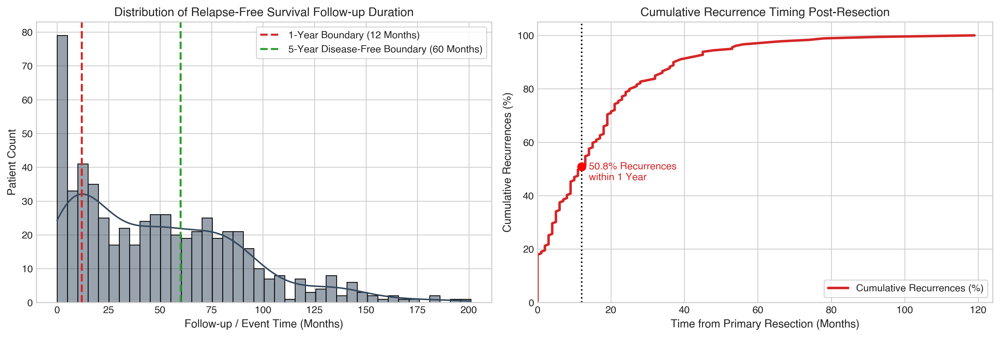
</p>

* **Figure 3:** Relapse-free survival timelines demonstrate that **over 33% of all recurrences occur within the first 12 months post-resection**, confirming the biological distinctiveness of the 1-year endpoint.

---

### 5.2 Biomarker Discovery & Differential Expression

Genome-wide differential expression analysis (Welch's t-test with Benjamini-Hochberg FDR correction) between early recurrence ($n=56$) and disease-free ($n=193$) tumours found 1,144 genes at nominal $p < 0.05$, 218 at $p < 0.01$ and 28 at $p < 0.001$, but **no gene passes FDR $q < 0.10$**. The genes below are therefore *candidates for follow-up*, not established biomarkers.

<p align="center">
  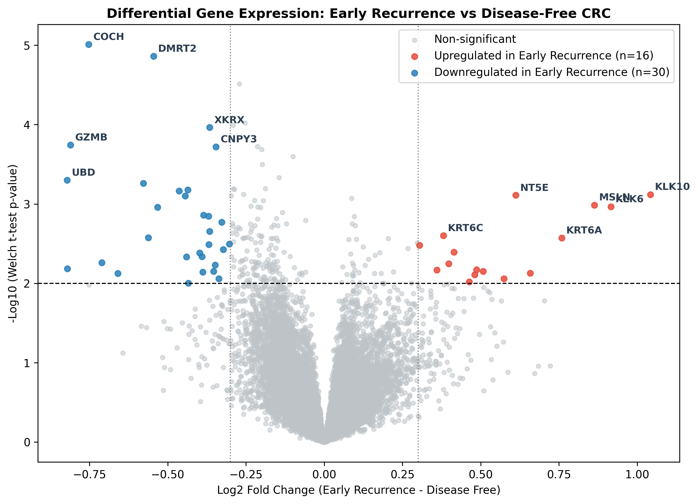
</p>

* **Figure 6 (Volcano Plot):** Genome-wide $\log_2 \text{Fold Change}$ versus $-\log_{10}(p\text{-value})$. Coloured points pass nominal $p < 0.01$ and $|\log_2\text{FC}| \ge 0.3$ (not FDR-corrected).

#### Top Phase 1 Candidate Genes (none FDR-significant):
| Gene Symbol | Full Biological Name | $\log_2$ FC | Nominal $p$-value | BH FDR $q$ | Published Role |
| :---: | :--- | :---: | :---: | :---: | :--- |
| **`COCH`** | Cochlin | $-0.75$ | $1.0 \times 10^{-5}$ | 0.15 | Extracellular matrix component. |
| **`DMRT2`** | Doublesex-Related Transcription Factor 2 | $-0.55$ | $1.4 \times 10^{-5}$ | 0.15 | Transcription factor; little prior CRC literature. |
| **`SPACA3`** | Sperm Acrosome Associated 3 | $-0.27$ | $3.0 \times 10^{-5}$ | 0.22 | Little prior CRC literature. |
| **`UBD`** | Ubiquitin D (FAT10) | $-0.82$ | $5.0 \times 10^{-4}$ | 0.69 | Inflammation-induced; reported in aggressive CRC. |
| **`KLK10`** | Kallikrein-Related Peptidase 10 | $+1.04$ | $7.6 \times 10^{-4}$ | 0.69 | Secreted serine protease; reported in CRC invasion. |
| **`MSLN`** | Mesothelin | $+0.86$ | $1.0 \times 10^{-3}$ | 0.71 | Cell-surface glycoprotein; reported in peritoneal spread. |
| **`KLK6`** | Kallikrein-Related Peptidase 6 | $+0.92$ | $1.1 \times 10^{-3}$ | 0.71 | Reported in EMT and chemoresistance. |

<p align="center">
  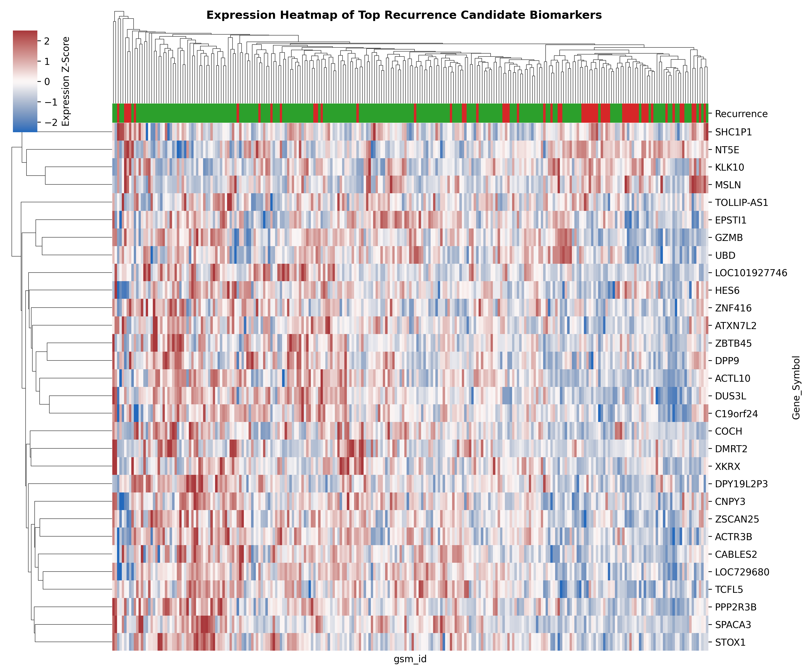
</p>

* **Figure 7:** Hierarchical clustering heatmap ($Z$-scores) of discovery candidate biomarkers across early recurrence (red bar) vs disease-free (green bar) patients.

<p align="center">
  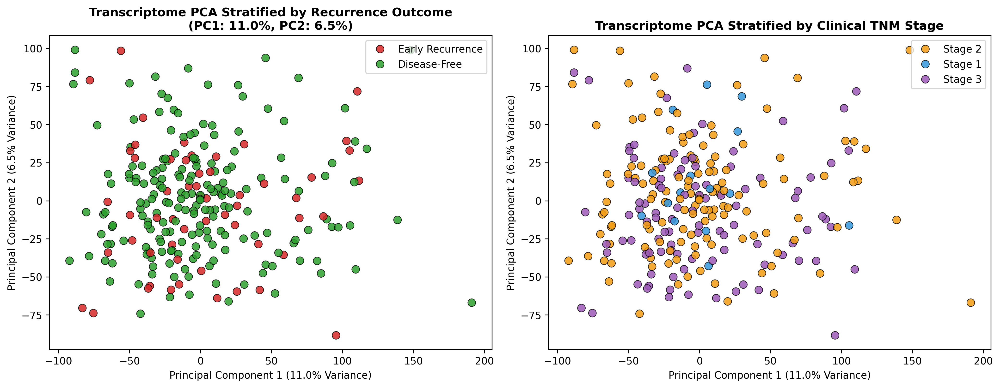
</p>

* **Figure 8:** Principal Component Analysis (PCA) of transcriptomic features stratified by Recurrence Outcome (Left) and TNM Stage (Right).

---

### 5.3 Phase 1 ML Benchmark & Strict Anti-Leakage Protocol

Four classifiers, each in a gene-only and a "genes + stage" form, were evaluated by **repeated nested cross-validation** on GSE39582 ($n=249$): 5 repeats × 5 outer stratified folds; inside each outer training fold a 3-fold GridSearchCV tuned the classifier hyperparameters and the number of selected genes (15 or 35), and the high-risk threshold was set by Youden's J on inner cross-validated predictions. Feature selection, scaling, tuning and threshold choice never saw the outer test fold. Reported AUC is that of the repeat-averaged out-of-fold probability (bootstrap 95% CI), with the spread across repeats.

<p align="center">
  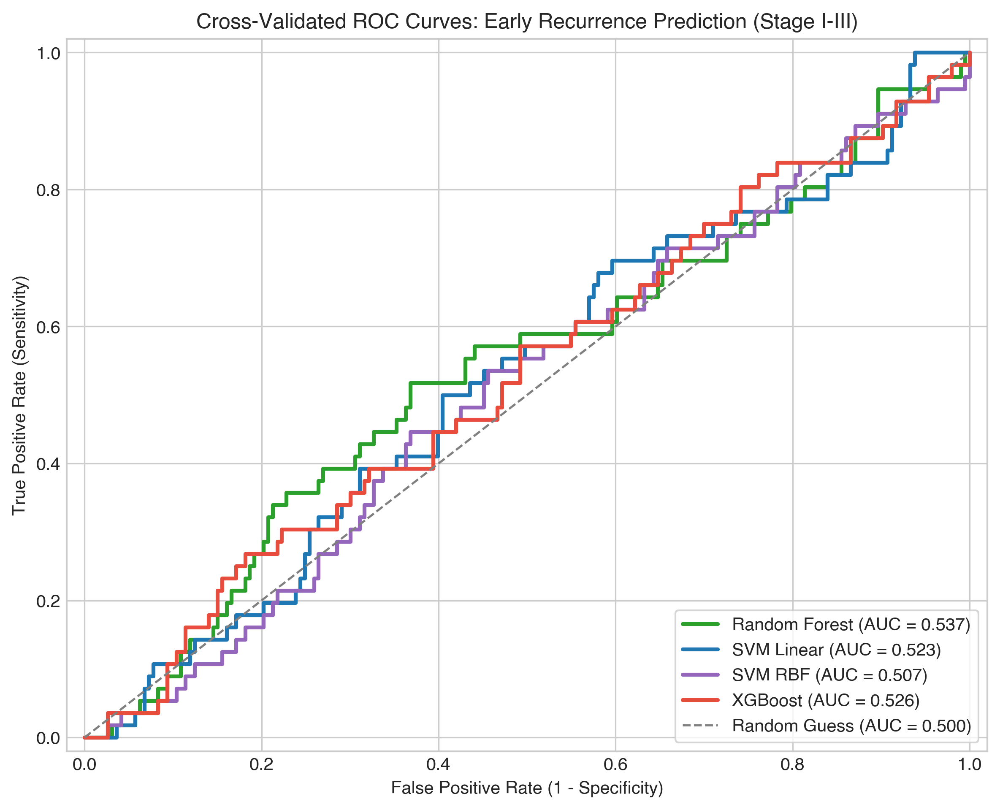
  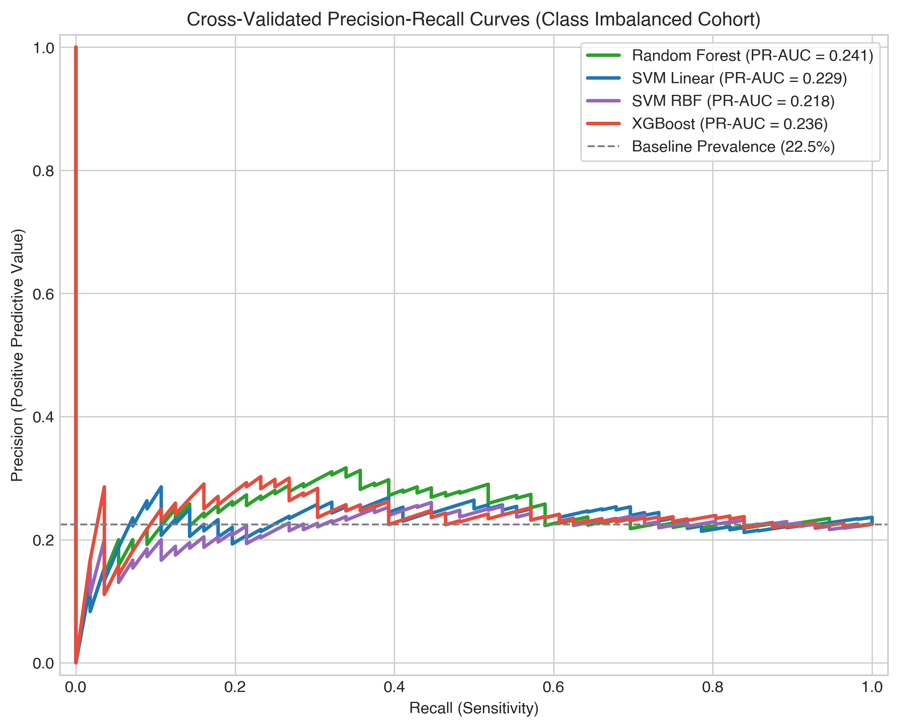
</p>

#### Phase 1 Nested-CV Performance (GSE39582, $n=249$):
| Model | ROC-AUC (95% CI) | Mean ± SD over repeats | PR-AUC | DeLong $p$ vs stage | Sensitivity* | Specificity* | Brier |
| :--- | :---: | :---: | :---: | :---: | :---: | :---: | :---: |
| **Stage only (no model)** | **0.626** (0.557–0.697) | — | 0.285† | — | — | — | — |
| Random Forest | 0.537 (0.451–0.625) | 0.521 ± 0.026 | 0.241 | 0.089 | 0.429 | 0.611 | 0.193 |
| SVM (Linear) | 0.523 (0.435–0.611) | 0.515 ± 0.041 | 0.229 | 0.059 | 0.518 | 0.560 | 0.204 |
| SVM (RBF) | 0.507 (0.422–0.594) | 0.510 ± 0.022 | 0.218 | 0.023 | 0.643 | 0.472 | 0.208 |
| XGBoost | 0.526 (0.438–0.613) | 0.513 ± 0.028 | 0.236 | 0.065 | 0.429 | 0.534 | 0.199 |
| Random Forest + stage | 0.536 (0.448–0.624) | 0.521 ± 0.015 | 0.243 | 0.082 | 0.482 | 0.591 | 0.196 |
| SVM (Linear) + stage | 0.539 (0.452–0.626) | 0.528 ± 0.031 | 0.237 | 0.087 | 0.607 | 0.461 | 0.201 |
| SVM (RBF) + stage | 0.528 (0.441–0.613) | 0.526 ± 0.012 | 0.236 | 0.046 | 0.607 | 0.461 | 0.201 |
| XGBoost + stage | 0.529 (0.440–0.616) | 0.520 ± 0.027 | 0.241 | 0.075 | 0.429 | 0.539 | 0.196 |

*At the threshold tuned inside each training fold (majority vote over repeats). †Average precision (trapezoidal PR-AUC over-interpolates a 3-level score). Prevalence: 22.5%.

**Interpretation:** once tuning is moved inside the folds, internal discrimination is close to chance (0.51–0.54) and stage alone is better (DeLong p = 0.02–0.09). The earlier hand-set hyperparameters gave 0.53–0.59, which shows how much optimism untuned-but-hand-picked settings can add. Calibration curves (Figure 25, `results/figures/fig25_calibration_curves.png`) are flat around the prevalence, consistent with this.

<p align="center">
  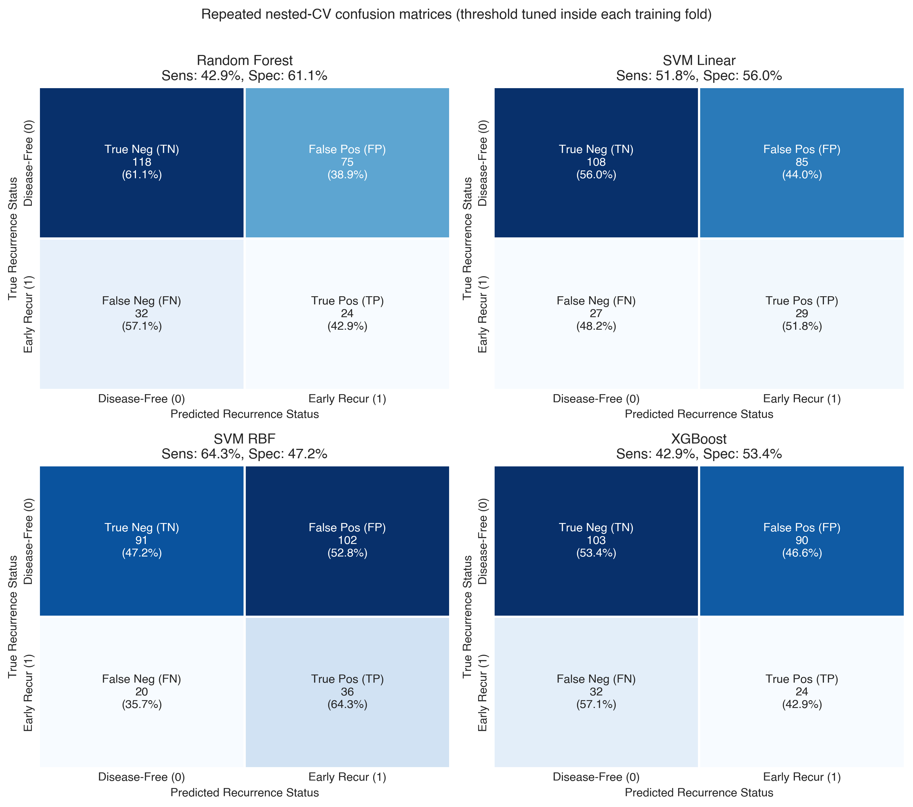
  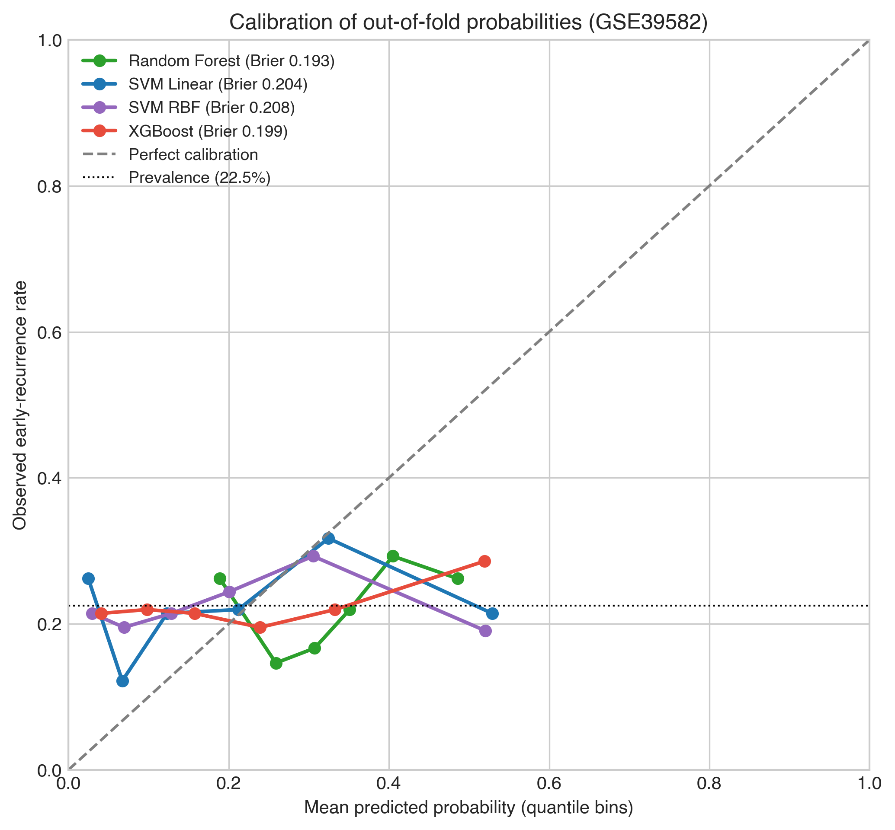
</p>

* **Figure 11:** Confusion matrices at the fold-tuned threshold across all 249 discovery cohort samples. **Figure 25:** Calibration of the out-of-fold probabilities.

---

### 5.4 Model Explainability with SHAP

Using Shapley Additive Explanations (SHAP) based on cooperative game theory, we quantified feature importance for each gene in the ensemble:

<p align="center">
  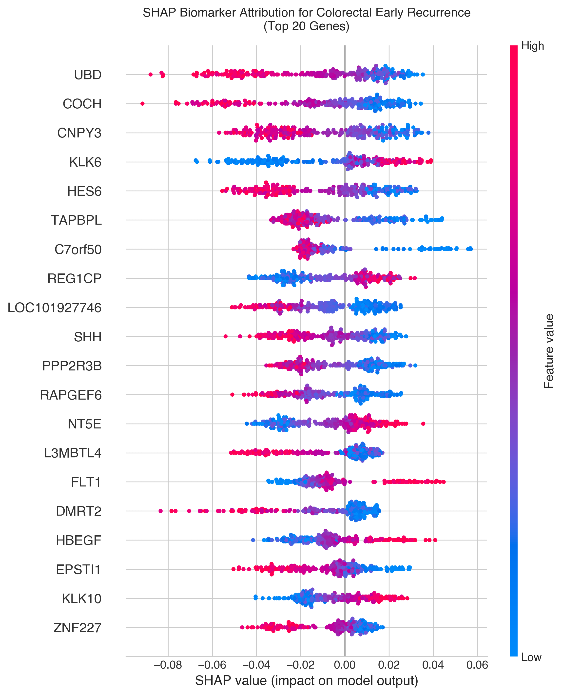
</p>

* **Figure 13 (SHAP Beeswarm Plot):** Top 20 genes ranked by mean absolute SHAP value in the deployed (full-cohort, tuned) Random Forest. The highest-ranked are *UBD*, *COCH*, *CNPY3*, *KLK6* and *HES6*.
* **Feature-selection stability** (`results/biomarkers/feature_selection_stability.csv`): across the 25 outer folds, only 2–6 genes per model are selected in at least half of the folds. The most stable is *EPSTI1* (84% of folds), followed by *DMRT2*, *UBD*, *HES6*, *KRT6A* and *HBEGF* (~50%).
* **Caveat:** SHAP explains what this model uses, not what drives recurrence. With nested-CV AUC ≈ 0.54 and unstable selection, these rankings are exploratory.

---

### 5.5 Blinded Independent External Validation (GSE14333)

To test generalization across institutions, frozen models (no retraining, no feature re-selection) were evaluated on **GSE14333**. Because GSE14333 was RMA-normalised separately (median gene level ~0.5 log2 units lower than GSE39582), each gene is first location/scale-matched to the training cohort using GSE14333's own *unlabelled* Stage I–III samples. Unaligned results are kept as a sensitivity analysis.

<p align="center">
  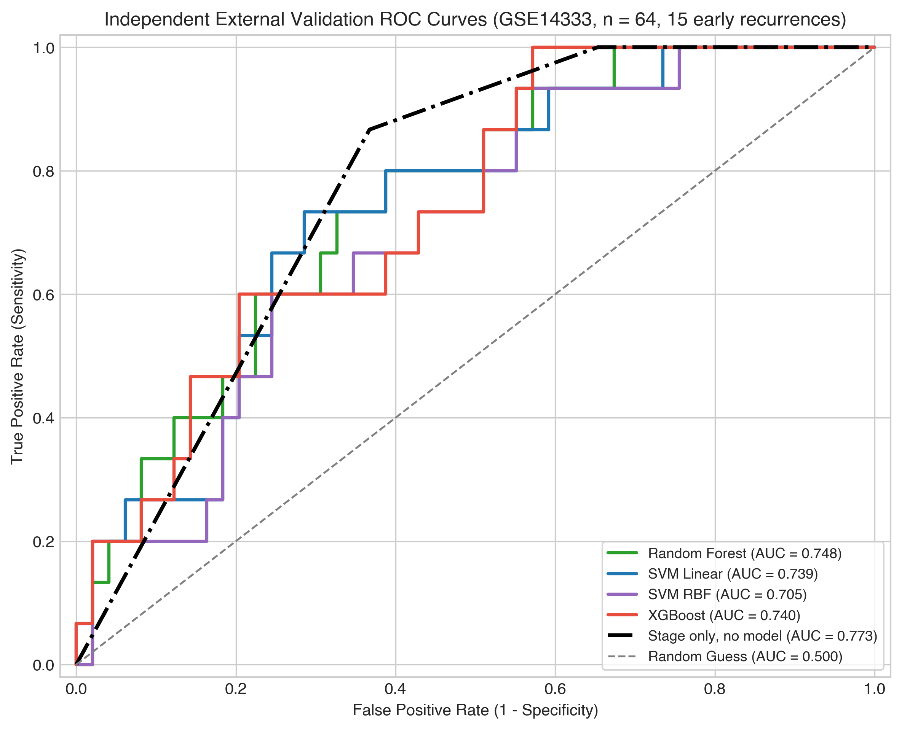
  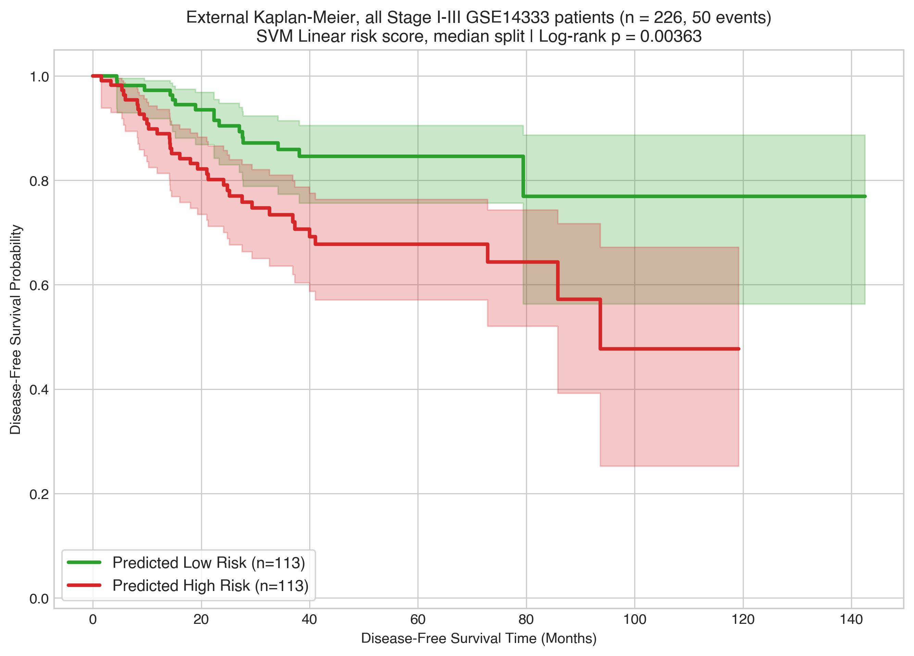
</p>

#### Binary endpoint (GSE14333, $n=64$: 15 early recurrences, 49 disease-free ≥ 5 yr):
| Model | ROC-AUC (95% CI) | PR-AUC | DeLong $p$ vs stage | AUC without alignment | Frozen threshold | Sensitivity | Specificity | Sensitivity at 0.50 |
| :--- | :---: | :---: | :---: | :---: | :---: | :---: | :---: | :---: |
| **Stage only (no model)** | **0.773** (0.675–0.855) | 0.406* | — | — | — | — | — | — |
| Random Forest | 0.748 (0.606–0.869) | 0.416 | 0.77 | 0.705 | 0.31 | 0.600 | 0.755 | 0.067 |
| SVM (Linear) | 0.739 (0.590–0.864) | 0.463 | 0.69 | 0.717 | 0.27 | 0.533 | 0.755 | 0.200 |
| SVM (RBF) | 0.705 (0.556–0.837) | 0.379 | 0.44 | 0.595 | 0.08 | 0.867 | 0.449 | 0.200 |
| XGBoost | 0.740 (0.600–0.862) | 0.465 | 0.69 | 0.675 | 0.18 | 0.600 | 0.694 | 0.267 |
| Random Forest + stage | 0.757 (0.615–0.881) | 0.460 | 0.84 | 0.735 | 0.37 | 0.733 | 0.653 | 0.200 |
| SVM (Linear) + stage | 0.744 (0.593–0.869) | 0.483 | 0.72 | 0.703 | 0.08 | 0.933 | 0.265 | 0.133 |
| SVM (RBF) + stage | 0.757 (0.612–0.876) | 0.404 | 0.83 | 0.646 | 0.11 | 0.800 | 0.592 | 0.200 |
| XGBoost + stage | 0.773 (0.629–0.895) | 0.546 | 1.00 | 0.729 | 0.09 | 0.667 | 0.735 | 0.333 |

*Average precision for the stage score. Prevalence: 23.4%. Thresholds were frozen from the discovery cohort (Youden's J on 5-fold CV predictions of the deployed model).

#### Survival endpoint (all Stage I–III patients with DFS in two independent cohorts):
| Model | GSE14333 C-index ($n=226$, 50 events) | GSE14333 stage-adj. HR per SD (95% CI), $p$ | GSE17536 C-index ($n=135$, 32 events) | GSE17536 stage-adj. HR per SD (95% CI), $p$ |
| :--- | :---: | :---: | :---: | :---: |
| **Stage only** | **0.675** | — | **0.657** | — |
| Random Forest | 0.628 | 1.43 (1.12–1.83), 0.004 | 0.606 | 1.40 (1.01–1.94), 0.045 |
| SVM (Linear) | 0.630 | 1.47 (1.17–1.86), 0.001 | 0.653 | 1.59 (1.20–2.12), 0.002 |
| SVM (RBF) | 0.625 | 1.35 (1.08–1.68), 0.008 | 0.651 | 1.54 (1.16–2.04), 0.003 |
| XGBoost | 0.629 | 1.38 (1.11–1.72), 0.004 | 0.610 | 1.33 (0.99–1.78), 0.055 |
| Random Forest + stage | 0.636 | 1.48 (1.14–1.92), 0.004 | 0.618 | 1.47 (1.03–2.09), 0.033 |
| SVM (Linear) + stage | 0.643 | 1.43 (1.12–1.83), 0.004 | **0.676** | 1.63 (1.21–2.21), 0.001 |
| SVM (RBF) + stage | 0.650 | 1.35 (1.08–1.68), 0.007 | **0.676** | 1.55 (1.17–2.06), 0.002 |
| XGBoost + stage | 0.618 | 1.40 (1.14–1.71), 0.001 | 0.593 | 1.30 (0.98–1.72), 0.069 |

GSE17536 (Moffitt, GPL570) was never used for training, tuning or threshold choice; it is aligned to the training cohort the same way as GSE14333. Table: `results/tables/external_survival_validation.csv`.

* **Key finding:** On the 64-patient binary endpoint no model beats stage alone, and the confidence intervals are wide. On survival, the frozen gene risk score is **independently prognostic after adjusting for stage in two separate external cohorts** (HR ≈ 1.3–1.6 per SD), so expression adds information to stage even though it does not replace it. Stage-combined SVM scores slightly exceed stage alone in GSE17536 (C-index 0.676 vs 0.657). This contrasts with the near-chance internal binary estimate, which is based on only 56 events.
* **Figure 15 (Kaplan–Meier):** All 226 Stage I–III patients split at the median Linear SVM risk score (pre-specified model): log-rank $p = 3.6 \times 10^{-3}$.
* **Thresholds matter:** at 0.50 the models catch 7–33% of early recurrences; at the frozen discovery-derived thresholds, 53–93%. Without cross-cohort alignment, AUC also drops (by up to 0.11).

---

### 5.6 Paired Colorectal Liver Metastasis Analysis (GSE50760)

We interrogated RNA-sequencing profiles from 18 matched triplets (**GSE50760**: Normal Mucosa $\to$ Primary CRC $\to$ Liver Metastasis = 54 samples).

**Normal-liver admixture.** The mean log2 FPKM of 30 hepatocyte genes (ALB, APOA1, FGA/FGB/FGG, SERPINA1, CYP2E1, …) is 1.1 in primary tumours but 7.6 in metastases; 15 of 18 metastasis samples carry a strong liver signal and 3 (AMC_3, AMC_13, AMC_22) almost none (`results/tables/metastasis_liver_content_scores.csv`). Without adjustment, "metastasis vs primary" differences are dominated by liver tissue: the unadjusted top pathways were complement/coagulation, bile secretion and cytochrome P450 metabolism.

**Liver-adjusted paired analysis.** For each gene, the within-patient difference (metastasis − primary) is regressed on that pair's excess hepatocyte signal; the intercept estimates the metastasis effect at zero liver admixture.

* **Result:** 700 genes reach FDR < 0.05 unadjusted, but **none after liver adjustment** (lowest FDR ≈ 1.0, also after restricting to the 13,131 expressed genes). The hepatocyte markers themselves lose significance after adjustment, as expected. With 18 pairs, this dataset cannot separate tumour-intrinsic metastasis changes from liver admixture.
* **Consequences:** no pathway enrichment is reported (no adjusted-significant genes), and **no recurrence candidate overlaps** with an adjusted-significant metastasis gene. The previous "43 shared biomarkers" counted every recurrence candidate that was merely measured in GSE50760.

<p align="center">
  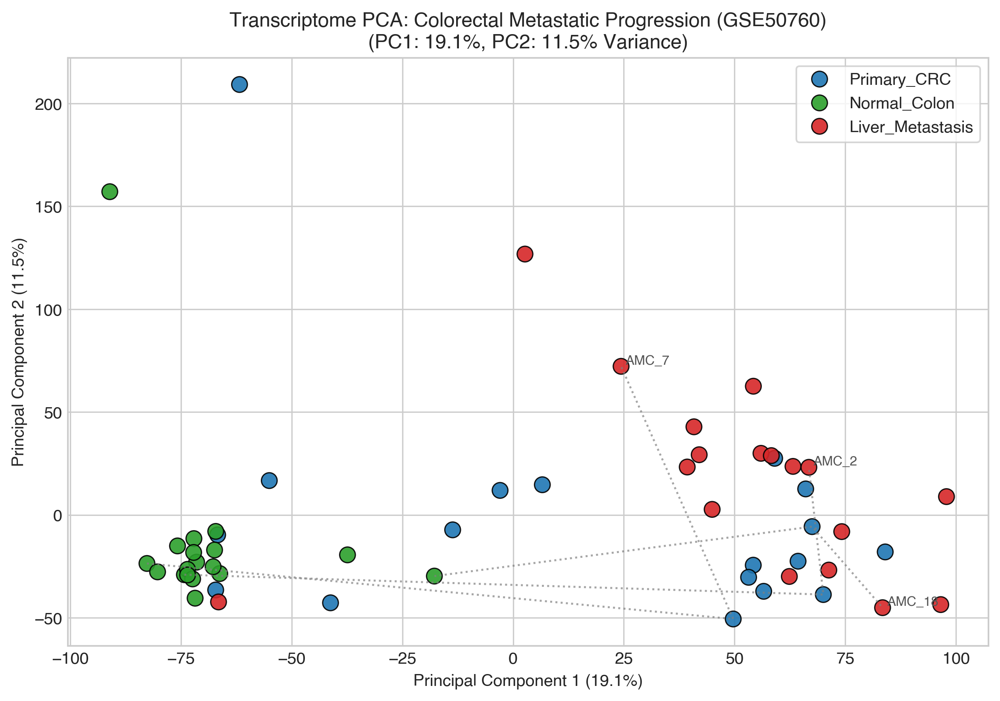
  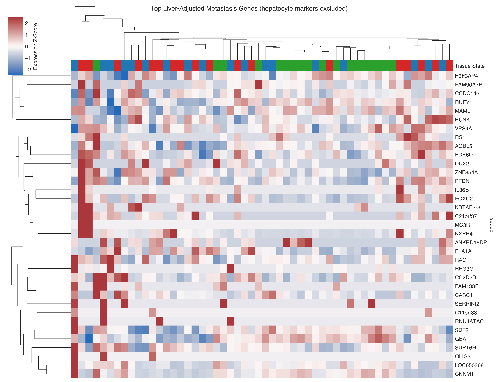
</p>

* **Figure 16 (PCA):** Normal colon, primary tumour and liver metastasis samples; lines join tissues from the same patient. The metastasis separation on PC1 is largely the liver signal.
* **Figure 17:** Top liver-adjusted genes (none FDR-significant; hepatocyte markers excluded).

---

### 5.7 Survival Modelling (XGBoost-Cox) and Two-Cohort Survival Validation

Because the binary endpoint discards every patient with intermediate outcomes, a survival model was trained on **all 485 Stage I–III GSE39582 tumours with RFS** (137 events, median follow-up 50 months), using censored follow-up directly ([`src/survival_model.py`](src/survival_model.py)).

* **Model (within project scope):** XGBoost with the `survival:cox` objective, gene-only and genes + stage.
* **Leakage control:** inside each training fold, genes are filtered by variance and ranked by |correlation| with null-model martingale residuals (50 or 150 kept), then scaled. Repeated nested CV (5 × 5 outer, event-stratified; 3-fold inner grid search on Harrell's C-index over gene count, depth and learning rate).
* **External scoring:** final model tuned on all 485 patients and frozen, including a high/low cut-off at the discovery median risk.

| Cohort | Model | C-index (95% CI) | Stage-adj. HR per SD (95% CI) | LR test $p$ vs stage |
| :--- | :--- | :---: | :---: | :---: |
| GSE39582 nested CV ($n=485$, 137 events) | **Stage only** | **0.619** (0.577–0.659) | — | — |
| | XGB-Cox genes | 0.587 (0.540–0.635) | 1.24 (1.05–1.48) | 0.013 |
| | XGB-Cox genes + stage | 0.599 (0.552–0.647) | 1.24 (1.04–1.48) | 0.017 |
| GSE14333 ($n=226$, 50 events) | **Stage only** | **0.675** (0.611–0.744) | — | — |
| | XGB-Cox genes | 0.597 (0.511–0.680) | 1.51 (1.14–2.00) | 0.005 |
| | XGB-Cox genes + stage | 0.616 (0.537–0.689) | 1.30 (0.98–1.72) | 0.072 |
| GSE17536 ($n=135$, 32 events) | **Stage only** | **0.657** (0.566–0.737) | — | — |
| | XGB-Cox genes | 0.511 (0.418–0.610) | 1.02 (0.71–1.47) | 0.91 |
| | XGB-Cox genes + stage | 0.555 (0.445–0.659) | 1.05 (0.73–1.53) | 0.78 |

<p align="center">
  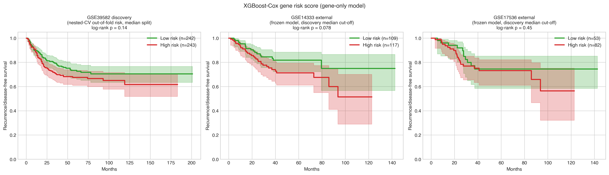
</p>

* **Figure 26:** Kaplan–Meier curves for the gene-only XGBoost-Cox score: out-of-fold median split in GSE39582 (log-rank $p = 0.14$), and the frozen discovery-median cut-off in GSE14333 ($p = 0.078$) and GSE17536 ($p = 0.45$).
* **Interpretation:** the survival model adds modestly to stage internally (LR $p = 0.013$) and in GSE14333, but **not in GSE17536**, whereas the binary classifiers trained on the 249 extreme-outcome patients replicate in both external cohorts (5.5). Training on clear-cut early-relapse vs long-term disease-free tumours appears to give a more transferable signature than modelling all follow-up times, possibly because censored and late events add label noise. The survival model's selected genes are dominated by proliferation/DNA-replication genes (*MCM6*, *CDC6*, *RFC5*, *STIL*; `results/biomarkers/survival_gene_selection_stability.csv`).
* **Caveat:** four classifiers × two variants × two cohorts were tested; the consistency across models and cohorts is more convincing than any single $p$-value, but a pre-registered single model on a further cohort would be the proper confirmation.

---

## 🚀 Phase 2: Large-Scale High-Throughput RNA-seq Cohort (TCGA-COADREAD)## 🚀 Phase 2: Large-Scale High-Throughput RNA-seq Cohort (TCGA-COADREAD)

### 6.1 Motivation & Large Cohort Characteristics

TCGA-COAD and TCGA-READ primary tumours (Illumina HiSeq V2, $\log_2(\text{norm\_count} + 1)$, 20,530 genes) were used to test the approach on RNA-seq. 306 Stage I–III primary tumours have expression and PFI data (Stage I 57, Stage II 136, Stage III 113).

---

### 6.2 Progression-Free Interval (PFI) Endpoint Definition

The PFI endpoint from the TCGA Pan-Cancer Clinical Data Resource (Liu et al., *Cell* 2018) is used with the **same curated rule as Phase 1**: Class 1 = PFI event ≤ 12 months, Class 0 = event-free with ≥ 60 months of follow-up, others excluded. TCGA follow-up is short, so only **57 of 306 patients** qualify (28 early events, 29 long-term event-free).

The earlier version used any PFI event on all 306 patients (66 events vs 240 "disease-free", many of whom had only short follow-up). That endpoint mixes late recurrences with early ones and labels short-follow-up patients as disease-free, so it is not comparable with Phase 1.

---

### 6.3 Phase 2 ML Model Training & Stratified 5-Fold CV Accuracy

With 57 patients, nested tuning is not feasible; the four models use fixed hyperparameters with fold-isolated feature selection, evaluated by 10 × repeated stratified 5-fold CV (repeat-averaged out-of-fold probabilities).

| Model | ROC-AUC (95% CI) | Mean over repeats | DeLong $p$ vs stage |
| :--- | :---: | :---: | :---: |
| **Stage only (no model)** | **0.635** (0.499–0.762) | — | — |
| Random Forest | 0.426 (0.283–0.580) | 0.431 | 0.030 |
| SVM (Linear) | 0.413 (0.267–0.565) | 0.422 | 0.024 |
| SVM (RBF) | 0.420 (0.278–0.576) | 0.446 | 0.033 |
| XGBoost | 0.397 (0.253–0.545) | 0.418 | 0.015 |

**Interpretation:** below-chance cross-validated AUC is a known artefact of selecting genes from ~20,000 noise-dominated features in very small samples; it means there is no detectable signal here, not an inverse one. TCGA cannot support conclusions about gene expression under the curated endpoint.

---

### 6.4 Phase 2 ROC, Precision-Recall & Confusion Matrix Analysis

<p align="center">
  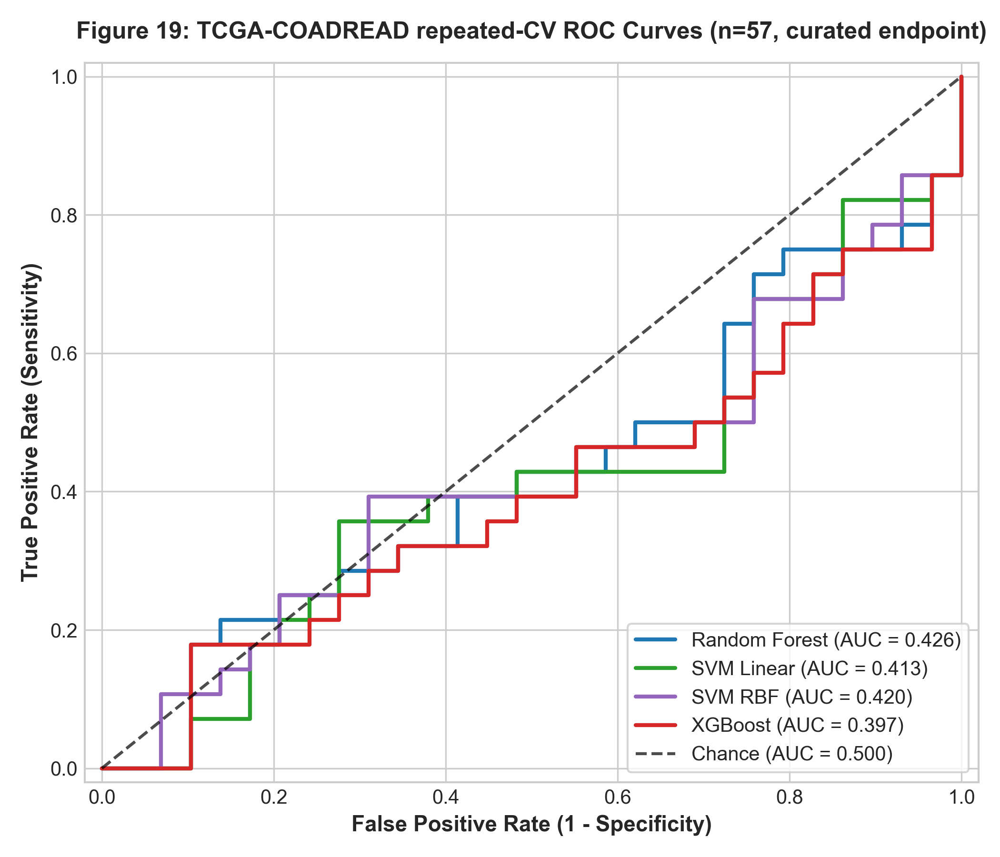
  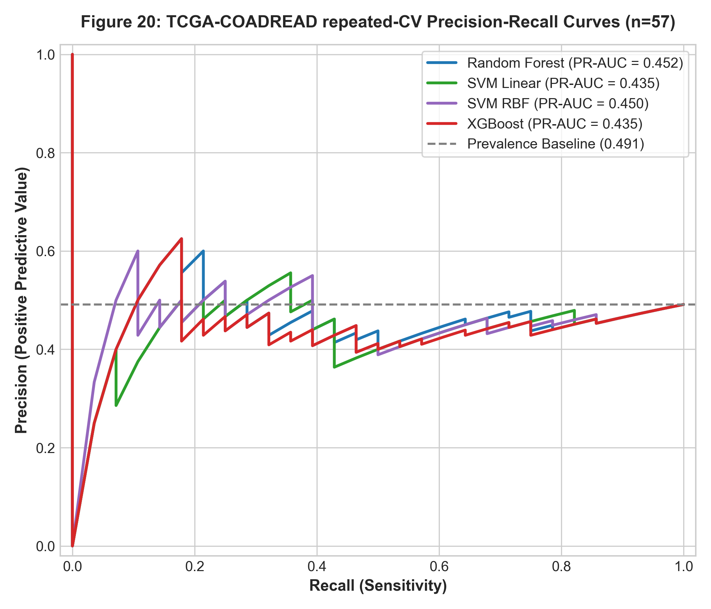
</p>

<p align="center">
  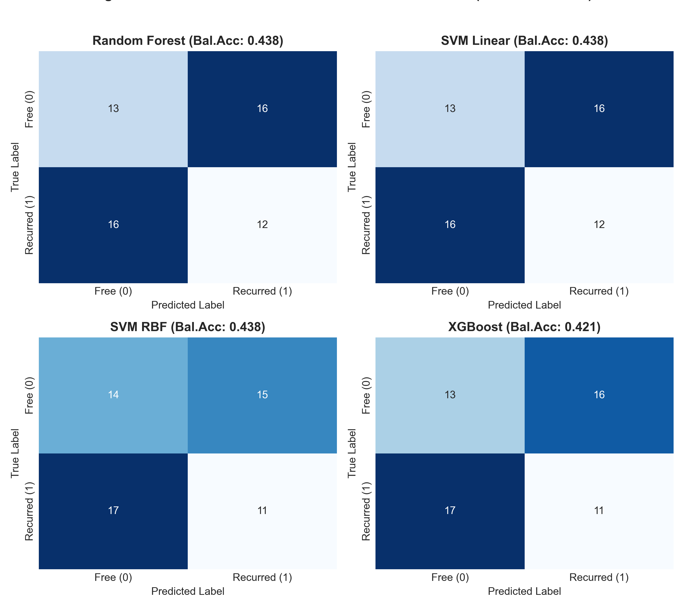
</p>

* **Figures 19–21:** Repeated-CV ROC, precision-recall and confusion matrices (0.50 threshold) for the 57 curated TCGA patients.

---

### 6.5 Cross-Platform Biological Concordance (Microarrays vs. RNA-seq)

16,262 genes overlap between GPL570 (21,755 genes) and TCGA HiSeq V2 (20,530 genes), so the Phase 1 candidate genes are measurable on both platforms. Detectability is not validation: none of the candidates shows predictive value in TCGA under the curated endpoint.

---

## 🌐 Phase 3: Combined Multi-Center GPL570 Mega-Cohort (Leave-One-Cohort-Out)

### 7.1 Multi-Center Dataset Aggregation
Four studies on the identical Affymetrix GPL570 platform (21,755 genes), with the **same curated endpoint as Phase 1** (recurrence ≤ 12 months vs disease-free ≥ 60 months; intermediate cases excluded):

| Cohort | Samples in series | Usable for the curated endpoint | Early recurrence |
| :--- | :---: | :---: | :---: |
| GSE39582 (French CIT) | 585 | 249 | 56 |
| GSE14333 (Melbourne) | 290 | 64 | 15 |
| GSE17536 (Moffitt) | 177 | 41 | 7 |
| GSE17537 (Vanderbilt) | 55 | 2 | 0 |
| **Total** | 1,107 | **356** | **78** (21.9%) |

The earlier version reported $n = 885$ because it used "any recurrence" as the event and counted short-follow-up censored patients as disease-free, which is the label noise the Phase 1 endpoint was designed to avoid.

### 7.2 Per-Cohort Standardisation
Each cohort is gene-wise z-scored on its own unlabelled Stage I–III tumours. This removes cohort-level location/scale differences without letting a held-out cohort influence training (ComBat fitted on the pooled data before cross-validation, as in the earlier version, does).

### 7.3 Phase 3 Leave-One-Cohort-Out Results
Each cohort is predicted by models trained only on the other cohorts, using the same fold-isolated feature selection as Phase 1.

#### ROC-AUC on each held-out cohort:
| Held-out cohort | n (events) | Stage only | Random Forest | SVM (Linear) | SVM (RBF) | XGBoost |
| :--- | :---: | :---: | :---: | :---: | :---: | :---: |
| GSE39582 | 249 (56) | **0.626** | 0.612 | 0.620 | 0.597 | 0.591 |
| GSE14333 | 64 (15) | 0.773 | **0.864** | 0.766 | 0.748 | 0.816 |
| GSE17536 | 41 (7) | 0.790 | 0.920 | **0.954** | **0.954** | 0.891 |
| GSE17537 | 2 (0) | — | — | — | — | — |

#### Pooled over all held-out predictions ($n = 356$):
| Model | ROC-AUC (95% CI) | PR-AUC | DeLong $p$ vs stage | Sensitivity | Specificity |
| :--- | :---: | :---: | :---: | :---: | :---: |
| **Stage only (no model)** | **0.680** (0.626–0.733) | 0.312 | — | — | — |
| Random Forest | 0.663 (0.592–0.731) | 0.337 | 0.70 | 0.231 | 0.889 |
| SVM (Linear) | 0.647 (0.574–0.713) | 0.346 | 0.47 | 0.282 | 0.892 |
| SVM (RBF) | 0.623 (0.550–0.692) | 0.329 | 0.22 | 0.282 | 0.910 |
| XGBoost | 0.631 (0.557–0.701) | 0.338 | 0.26 | 0.282 | 0.878 |

Hyperparameters are tuned by 3-fold GridSearchCV on the training cohorts only (same grids as Phase 1).

### 7.4 Phase 3 ROC, Precision-Recall & Confusion Matrix Analysis

<p align="center">
  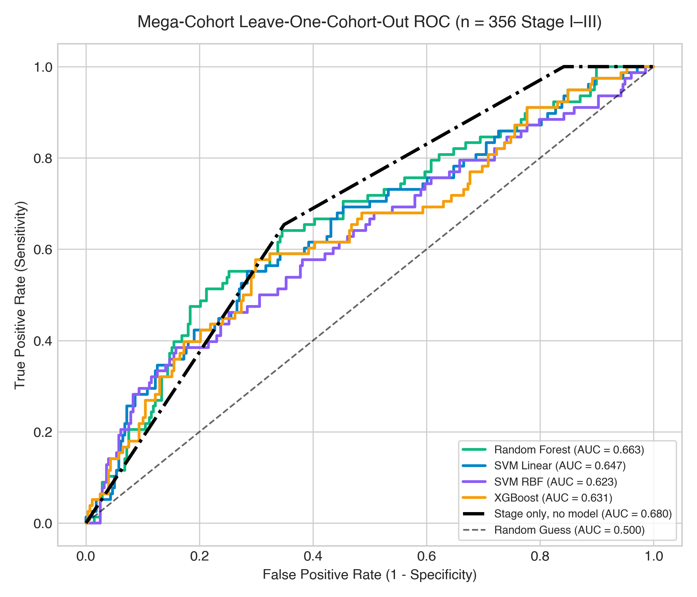
  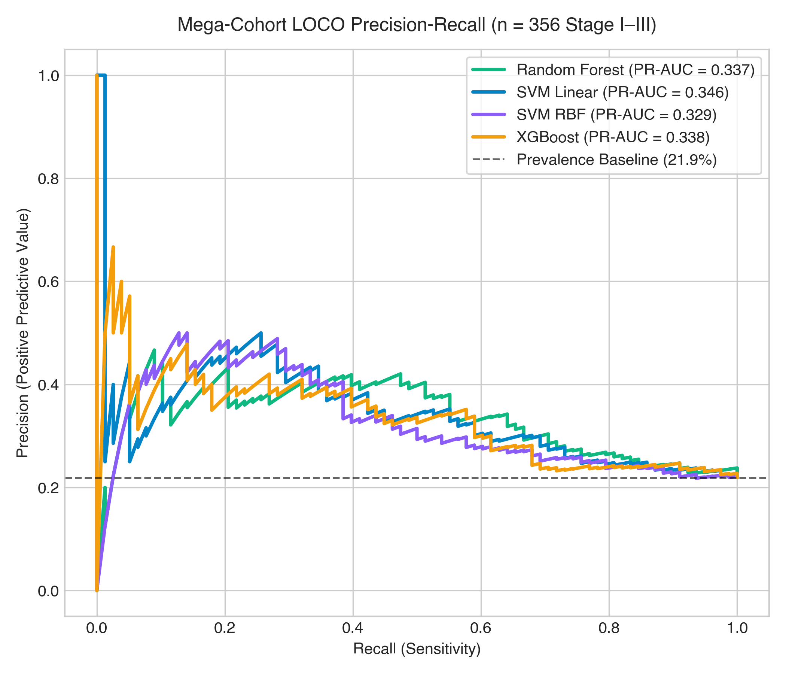
</p>

* **Figure 22:** Pooled leave-one-cohort-out ROC curves, with the stage-only baseline.
* **Figure 23:** Pooled Precision-Recall curves; the dashed line marks the 21.9% prevalence.

<p align="center">
  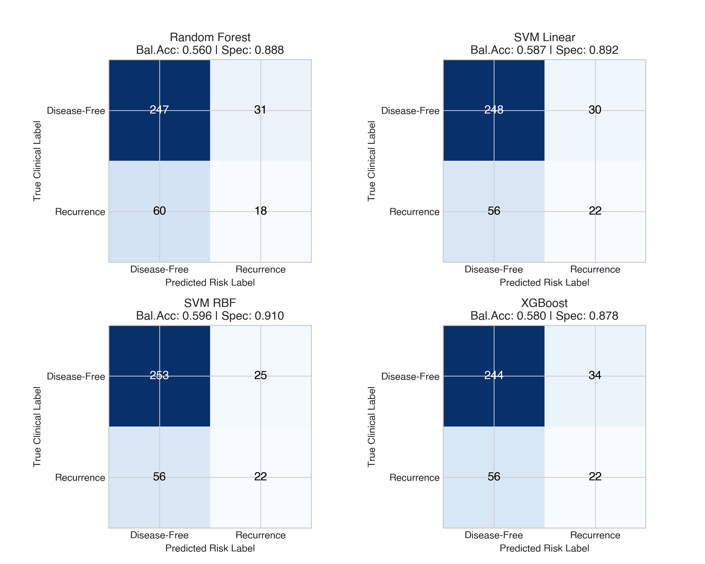
</p>

* **Figure 24:** Pooled confusion matrices at the 0.50 threshold.

### 7.5 Interpretation
1. **Pooling does not beat stage.** Pooled LOCO AUCs (0.62–0.66) are below stage alone (0.68). The previously reported jump from ~0.54 to ~0.66 came from changing the endpoint, not from more samples.
2. **The two smaller cohorts look better than stage**, especially GSE14333 (Random Forest 0.86 vs stage 0.77), but they have only 15 and 7 events. Treat this as a promising signal that needs a larger, properly powered external cohort.
3. **Pooled AUC is lower than the per-cohort AUCs** because predicted probabilities are not calibrated across cohorts; the per-cohort table is the fairer view.

---

## 💻 Interactive Clinical Web Dashboard (`app.py`)

The repository includes a modern, production-grade Streamlit web application tailored for dissertation presentations, clinical demonstration, and interactive model exploration.

```bash
streamlit run app.py
```

### Dashboard Features:
1. **🏥 Interactive Patient Recurrence Predictor:**
   - Switch between **Phase 1 Discovery (GSE39582, n=249)**, **Phase 1 External (GSE14333, n=64)**, **Phase 2 (TCGA-COADREAD, n=57)** and the **Phase 3 mega-cohort**. Training-cohort patients are shown their out-of-fold (cross-validated) prediction, not an in-sample score.
   - Select individual patient barcodes to inspect real-time recurrence risk probability, binary classification, true clinical outcome, follow-up duration, and TNM/pathologic stage.
   - Real-time comparison table of patient transcript abundance versus cohort mean for key biomarkers (*KLK10*, *UBD*, *MSLN*, *DMRT2*, *COCH*, *FLT1*, *MMP3*, *SPACA3*).
2. **🤖 Multi-Phase ML Model Benchmarks:**
   - Dedicated interactive tabs for **Phase 1 (Microarrays)** and **Phase 2 (RNA-seq)** displaying full out-of-fold metrics tables, ROC curves, PR curves, and confusion matrices.
3. **🔬 Differential Expression Analysis:**
   - Interactive volcano plot, hierarchical clustering heatmap, PCA projections, and searchable candidate gene tables with Benjamini-Hochberg FDR filtering.
4. **🌐 Independent External Validation (GSE14333):**
   - External generalization results (gene models 0.70–0.75 ROC-AUC vs 0.77 for stage alone) and stage-adjusted survival validation.
5. **🫀 Liver Metastasis Progression Dynamics (GSE50760):**
   - Paired triplet analysis (Normal Mucosa $\to$ Primary Tumor $\to$ Liver Metastasis), shared biomarker overlap, and KEGG/GO pathway enrichment tables.
6. **📖 Biological Mechanisms & Safeguards:**
   - In-depth oncogenic rationale for discovered kallikreins, *UBD/FAT10*, *MSLN*, and *FLT1*, alongside documentation of anti-leakage engineering safeguards.

---

## 📁 Repository Structure & Quickstart Guide

```text
CRC-ML-Model/
├── PRD.md                             # Product Requirements Document
├── DESIGN.md                          # 10-Milestone Architectural Blueprint
├── CLAUDE.md / cloude.md              # Engineering Standards & Anti-Leakage Rules
├── requirements.txt                   # Pinned Python Dependencies (Python 3.10)
├── app.py                             # Interactive Multi-Cohort Clinical Dashboard
│
├── data/
│   ├── raw/
│   │   ├── GSE39582/                  # Phase 1 Discovery Series Matrix (164.2 MB)
│   │   ├── GSE14333/                  # Phase 1 External Validation Matrix (80.8 MB)
│   │   ├── GSE50760/                  # Phase 1 Paired Metastasis RNA-seq (7.4 MB)
│   │   ├── TCGA_COADREAD/             # Phase 2 TCGA HiSeq & Clinical (24 MB)
│   │   └── GPL570.annot.gz            # Probe Annotations (8.1 MB)
│   ├── processed/
│   │   ├── clinical/                  # Phase 1 Curated Clinical Outcomes
│   │   ├── expression/                # Phase 1 Snappy Parquet Matrices (float32)
│   │   └── tcga/                      # Phase 2 Processed Parquet & Clinical
│   │       ├── TCGA_COADREAD_features.parquet (57 curated samples x 20,530 genes)
│   │       ├── TCGA_COADREAD_clinical.csv     (57 samples, curated PFI targets)
│   │       └── tcga_oof_predictions.csv       (5-Fold OOF Predictions)
│   └── external_validation/           # GSE14333 Processed Features & Targets
│
├── src/                               # Modular Pipeline Source Code
│   ├── data_loader.py                 # Automated GEO Download Engine
│   ├── clinical_labels.py             # Phase 1 Recurrence Labeling Engine
│   ├── preprocessing.py               # Probe-to-Gene Collapse Engine
│   ├── feature_selection.py           # Fold-Isolated Selector Transformer
│   ├── model_training.py              # Phase 1 Repeated Nested CV, Thresholds & Serialization
│   ├── evaluation.py                  # Phase 1 Evaluation, KM & SHAP
│   ├── external_validation.py         # Frozen Validation on GSE14333 (+ GSE17536 survival)
│   ├── survival_model.py              # XGBoost-Cox Survival Model & Two-Cohort Validation
│   ├── stats_utils.py                 # Bootstrap CIs & DeLong Test
│   ├── megacohort_pipeline.py         # Phase 3 Leave-One-Cohort-Out Benchmark
│   ├── metastasis_analysis.py         # Phase 1 Paired Triplet Analysis
│   ├── visualization.py               # Standardized Plotting Engine
│   ├── tcga_preprocessing.py          # Phase 2 TCGA Ingestion & PFI Extraction
│   └── tcga_model_training.py         # Phase 2 TCGA Repeated CV & Serialization
│
├── models/
│   ├── random_forest/                 # Phase 1 Serialized Random Forest
│   ├── svm_linear/                    # Phase 1 Serialized Linear SVM
│   ├── svm_rbf/                       # Phase 1 Serialized RBF SVM
│   ├── xgboost/                       # Phase 1 Serialized XGBoost
│   └── phase2_tcga/                   # Phase 2 Serialized TCGA Pipelines
│       ├── Random_Forest_tcga.joblib
│       ├── SVM_Linear_tcga.joblib
│       ├── SVM_RBF_tcga.joblib
│       └── XGBoost_tcga.joblib
│
├── results/
│   ├── figures/                       # Publication Figures (PNG & PDF)
│   │   ├── fig01 - fig18              # Phase 1 Discovery, Validation & Metastasis
│   │   └── fig19 - fig21              # Phase 2 TCGA ROC, PR & Confusion Matrices
│   ├── tables/                        # CSV Metric Summaries & Comparisons
│   │   ├── model_comparison_metrics.csv
│   │   ├── external_validation_summary.csv
│   │   └── phase2_tcga_model_comparison.csv
│   ├── metrics/                       # Detailed JSON Cross-Validation Records
│   └── biomarkers/                    # Candidate Biomarkers & SHAP Rankings
│
└── reports/                           # Academic Documentation
    ├── dissertation_summary.md        # M.Tech Dissertation Summary Chapter
    ├── methodology.md                 # Detailed Experimental Methodology
    └── limitations.md                 # Methodological & Clinical Discussion
```

### Reproducing the Entire Pipeline:

```bash
# 1. Clone repository & initialize virtual environment
git clone <repo-url>
cd CRC-ML-Model
python3.10 -m venv .venv
source .venv/bin/activate
pip install -r requirements.txt

# 2. Phase 1: Microarray Pipeline Execution
python src/data_loader.py              # Download GSE39582 & annotations
python src/clinical_labels.py          # Curate 249 Stage I-III recurrence labels
python src/preprocessing.py            # Max-variance probe collapse to 21,755 genes
python src/feature_selection.py        # Differential expression & volcano plot
python src/model_training.py           # Repeated nested CV on GSE39582 (~5 min)
python src/evaluation.py               # Evaluation, KM curves & SHAP attribution
python src/megacohort_pipeline.py      # Builds the 4-cohort cache (needs GSE14333/17536/17537 downloads) + LOCO
python src/external_validation.py      # Frozen validation on GSE14333; survival on GSE14333 + GSE17536
python src/survival_model.py           # XGBoost-Cox survival model + two-cohort validation
python src/metastasis_analysis.py      # Paired metastasis analysis on GSE50760

# 3. Phase 2: Large-Scale TCGA RNA-seq Pipeline Execution
python src/tcga_preprocessing.py       # Preprocess TCGA-COADREAD (57 of 306 meet the curated endpoint)
python src/tcga_model_training.py      # 10x repeated 5-fold CV on TCGA RNA-seq

# 4. Launch the Interactive Web Dashboard
streamlit run app.py
```

---

## ⚖️ Academic Disclaimer & Ethics

This project is an **academic research prototype** developed as part of an M.Tech bioinformatics curriculum. It is intended for computational research and biological hypothesis generation only and is **not certified as a clinical diagnostic or treatment decision tool**. All predictive biomarkers identified (*KLK10*, *KLK6*, *MSLN*, *UBD*, *FLT1*) represent candidate hypotheses requiring prospective clinical validation. All data used is open-access and de-identified, adhering to NCBI GEO and NIH NCI Genomic Data Commons (GDC) data use policies.
