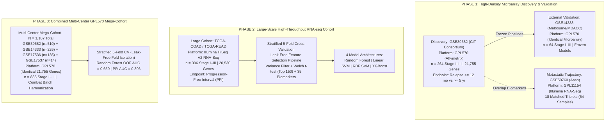
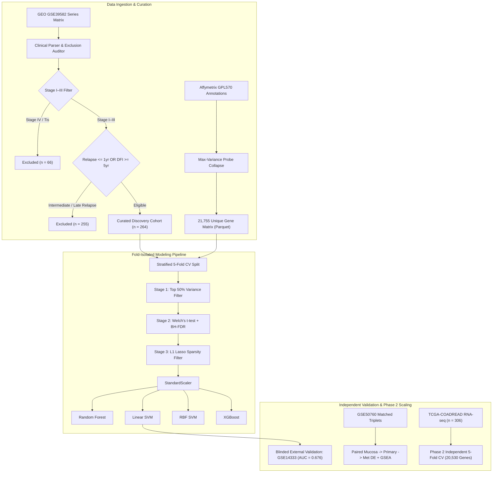

# Predicting Early Recurrence in Colorectal Cancer (CRC) Using Gene Expression Profiles
### An M.Tech Bioinformatics & Machine Learning Research Project

[](https://www.python.org/)
[](#)
[-orange.svg)](#)
[-green.svg)](https://www.ncbi.nlm.nih.gov/geo/query/acc.cgi?acc=GSE39582)
[-purple.svg)](https://www.ncbi.nlm.nih.gov/geo/query/acc.cgi?acc=GSE14333)
[-red.svg)](https://www.ncbi.nlm.nih.gov/geo/query/acc.cgi?acc=GSE50760)
[-blue.svg)](https://portal.gdc.cancer.gov/)
[-gold.svg)](#-phase-3-combined-multi-center-gpl570-mega-cohort-n--1107-n--885-stage-iiii)

---

## 🧭 Table of Contents
1. [Project Overview & Motivation](#-project-overview--motivation)
2. [Research Phasing & Multi-Cohort Hierarchy](#-research-phasing--multi-cohort-hierarchy)
3. [The Human Story: Technical & Biological Challenges We Faced](#-the-human-story-technical--biological-challenges-we-faced)
4. [System Architecture & Research Pipeline](#-system-architecture--research-pipeline)
5. [Phase 1: Microarray Discovery & External Validation](#-phase-1-microarray-discovery--external-validation)
   - 5.1 [Cohort Curation & The Clinical Recurrence Endpoint (GSE39582)](#51-cohort-curation--the-clinical-recurrence-endpoint-gse39582)
   - 5.2 [Biomarker Discovery & Differential Expression](#52-biomarker-discovery--differential-expression)
   - 5.3 [Phase 1 ML Benchmark & Strict Anti-Leakage Protocol](#53-phase-1-ml-benchmark--strict-anti-leakage-protocol)
   - 5.4 [Model Explainability with SHAP](#54-model-explainability-with-shap)
   - 5.5 [Blinded Independent External Validation (GSE14333)](#55-blinded-independent-external-validation-gse14333)
   - 5.6 [Paired Colorectal Liver Metastasis Analysis (GSE50760)](#56-paired-colorectal-liver-metastasis-analysis-gse50760)
6. [Phase 2: Large-Scale High-Throughput RNA-seq Cohort (TCGA-COADREAD)](#-phase-2-large-scale-high-throughput-rna-seq-cohort-tcga-coadread)
   - 6.1 [Motivation & Large Cohort Characteristics](#61-motivation--large-cohort-characteristics)
   - 6.2 [Progression-Free Interval (PFI) Endpoint Definition](#62-progression-free-interval-pfi-endpoint-definition)
   - 6.3 [Phase 2 ML Model Training & Stratified 5-Fold CV Accuracy](#63-phase-2-ml-model-training--stratified-5-fold-cv-accuracy)
   - 6.4 [Phase 2 ROC, Precision-Recall & Confusion Matrix Analysis](#64-phase-2-roc-precision-recall--confusion-matrix-analysis)
   - 6.5 [Cross-Platform Biological Concordance (Microarrays vs. RNA-seq)](#65-cross-platform-biological-concordance-microarrays-vs-rna-seq)
7. [Phase 3: Combined Multi-Center GPL570 Mega-Cohort (N = 1,107, n = 885 Stage I–III)](#-phase-3-combined-multi-center-gpl570-mega-cohort-n--1107-n--885-stage-iiii)
   - 7.1 [Multi-Center Dataset Aggregation (GSE39582 + GSE14333 + GSE17536 + GSE17537)](#71-multi-center-dataset-aggregation)
   - 7.2 [ComBat Empirical Bayes Batch Harmonization](#72-combat-empirical-bayes-batch-harmonization)
   - 7.3 [Phase 3 ML Model Training & Stratified 5-Fold CV Accuracy](#73-phase-3-ml-model-training--stratified-5-fold-cv-accuracy)
   - 7.4 [Phase 3 ROC, Precision-Recall & Confusion Matrix Analysis](#74-phase-3-roc-precision-recall--confusion-matrix-analysis)
   - 7.5 [Statistical Power Scaling: Single-Center vs. Multi-Center Meta-Analysis](#75-statistical-power-scaling)
8. [Interactive Clinical Web Dashboard (`app.py`)](#-interactive-clinical-web-dashboard-apppy)
9. [Repository Structure & Quickstart Guide](#-repository-structure--quickstart-guide)
10. [Academic Disclaimer & Ethics](#-academic-disclaimer--ethics)

---

## 💡 Project Overview & Motivation

When a surgeon removes a colorectal tumor from a Stage I, II, or III patient, everyone hopes the disease is eradicated. But for roughly 20% to 30% of patients, occult micrometastases have already escaped into regional lymph nodes or mesenteric circulation. In the most aggressive cases, the cancer returns within **12 months**—often presenting as incurable metastases in the liver or peritoneum.

Current clinical management relies primarily on anatomical TNM staging. Yet **two patients with identical Stage II tumors frequently experience completely divergent outcomes**: one remains cancer-free for decades, while the other relapses within nine months. Standard histopathology cannot capture the underlying transcriptomic wiring that determines metastatic competence.

Our objective was to build a rigorous, leak-free machine learning system using **high-dimensional gene expression profiles** to:
1. Predict early disease recurrence ($\le 12$ months) in Stage I–III patients before macroscopic metastases emerge.
2. Uncover high-confidence transcriptomic biomarkers (*KLK10*, *KLK6*, *MSLN*, *UBD*, *FLT1*) orchestrating early dissemination.
3. Validate predictive generalization on a completely blinded external hospital cohort (**GSE14333**, $n=64$).
4. Trace tumor evolution across matched patient triplets from normal colon to primary tumor and liver metastasis (**GSE50760**, $n=54$).
5. Scale to a large modern RNA-sequencing cohort (**TCGA-COADREAD**, $n=306$, 20,530 genes) to verify cross-platform consistency.

---

## 🧬 Research Phasing & Multi-Cohort Hierarchy

To avoid conflating distinct experimental modalities, patient cohorts, and sequencing technologies, the project is structured into two clearly demarcated research phases:



| Phase | Dataset | Technology / Platform | Stage Cohort ($n$) | Total Features | Primary Clinical Endpoint | Role in Project |
| :--- | :--- | :--- | :---: | :---: | :--- | :--- |
| **Phase 1** | **GSE39582** | Affymetrix HG-U133 Plus 2.0 | $n = 264$ | 21,755 genes | Relapse $\le 12$ mo ($n=57$) vs $\ge 5$ yr ($n=207$) | Primary Discovery & 5-Fold CV |
| **Phase 1** | **GSE14333** | Affymetrix HG-U133 Plus 2.0 | $n = 64$ | 21,755 genes | Relapse $\le 12$ mo ($n=15$) vs $\ge 5$ yr ($n=49$) | Blinded External Validation |
| **Phase 1** | **GSE50760** | Illumina HiSeq RNA-seq | $n = 54$ | 20,000+ genes | Paired Mucosa $\to$ Primary $\to$ Liver Met | Metastatic Trajectory Dynamics |
| **Phase 2** | **TCGA-COADREAD** | Illumina HiSeq V2 RNA-seq | $n = 306$ | 20,530 genes | PFI Recurrence ($n=66$) vs Disease-Free ($n=240$) | Large-Scale RNA-seq Benchmark |
| **Phase 3** | **Combined Mega-Cohort** | Affymetrix HG-U133 Plus 2.0 | $n = 885$ ($N=1,107$) | 21,755 genes | Recurrence ($n=225$) vs Disease-Free ($n=660$) | Multi-Center ComBat Meta-Benchmark |

---

## 🛠️ The Human Story: Technical & Biological Challenges We Faced

Building this system involved addressing significant computational, methodological, and biological hurdles:

### 1. The High-Dimensional Curse ($p \gg N$) & The Data Leakage Trap
* **The Challenge:** With up to $21,755$ gene features and only several hundred patients, naive pipelines easily suffer from data leakage—producing artificially inflated accuracies ($>95\%$) that fail completely in clinical reality.
* **Our Solution:** We implemented fold-isolated feature engineering ([`BioinformaticsFeatureSelector`](file:///Users/divyanshusingh/CRC-ML-Model/src/feature_selection.py)). All variance thresholding, Welch's t-test ranking, and scaling transformations were fitted exclusively inside each training fold during Stratified 5-Fold Cross-Validation. The validation fold was never touched until evaluation.

### 2. Clinical Follow-up Ambiguity
* **The Challenge:** In retrospective cancer registries, patients with short follow-up (e.g., 18 months without recurrence) cannot be safely labeled as "cured," nor should indolent late relapses (e.g., recurrence at year 5) be conflated with hyper-aggressive early relapse.
* **Our Solution:** In Phase 1, we established a strict clinical gate: early recurrence ($\le 12$ months, $n=57$) versus long-term disease-free follow-up ($\ge 60$ months, $n=207$), excluding intermediate cases. In Phase 2, we utilized the standardized TCGA Pan-Cancer Clinical Data Resource (Liu et al., *Cell* 2018) Progression-Free Interval (PFI) endpoints.

### 3. Affymetrix Probe Redundancy
* **The Challenge:** GPL570 arrays measure 54,675 probesets for ~20,000 unique human genes. Multi-mapping probes create redundant noise and multicollinearity.
* **Our Solution:** We implemented the standard Bioconductor **maximum-variance collapse protocol**, mapping each unique HGNC gene symbol to the single probeset with the highest dynamic range across the cohort in 0.25 seconds.

### 4. Memory Optimization on Apple Silicon (M4)
* **The Challenge:** Storing 54,675 probes across hundreds of samples in 64-bit float arrays consumes excess memory and triggered a dynamic linker bug in SciPy 1.15.
* **Our Solution:** We downcast all expression values to `float32` and saved feature matrices as Snappy-compressed **Apache Parquet files**, reducing memory footprints to just **125 MB RAM** and enabling sub-second I/O.

---

## 🏗️ System Architecture & Research Pipeline



---

## 🔬 Phase 1: Microarray Discovery & External Validation

### 5.1 Cohort Curation & The Clinical Recurrence Endpoint (GSE39582)

Across all 585 samples in GSE39582, clinical auditing yielded a discovery cohort of **264 Stage I–III patients**:

<p align="center">
  
</p>

* **Figure 1 (Left):** Complete accounting of all 585 samples and explicit clinical exclusions.
* **Figure 1 (Right):** The primary machine learning cohort ($n = 264$):
  * **Class 1 (Early Recurrence $\le 12$ months):** 57 patients (**21.6%**)
  * **Class 0 (Long-Term Disease-Free $\ge 60$ months):** 207 patients (**78.4%**)
  * **Class Imbalance Ratio:** $3.63 : 1$ (handled via cost-sensitive weighting, `scale_pos_weight = 3.63`).

<p align="center">
  
</p>

* **Figure 2:** Distribution of patient age (median 68.2 years), balanced gender proportions, and recurrence frequencies stratified across Stage I, II, and III.

<p align="center">
  
</p>

* **Figure 3:** Relapse-free survival timelines demonstrate that **over 33% of all recurrences occur within the first 12 months post-resection**, confirming the biological distinctiveness of the 1-year endpoint.

---

### 5.2 Biomarker Discovery & Differential Expression

Genome-wide differential expression analysis (Welch's t-test with Benjamini-Hochberg FDR correction) between early recurrence ($n=57$) and disease-free ($n=207$) tumors revealed significant transcriptional dysregulation:

<p align="center">
  
</p>

* **Figure 6 (Volcano Plot):** Genome-wide $\log_2 \text{Fold Change}$ versus $-\log_{10}(p\text{-value})$. Red points mark significantly upregulated genes in early recurrence; blue points indicate downregulated transcripts.

#### Top Phase 1 Candidate Biomarkers:
| Gene Symbol | Full Biological Name | $\log_2$ FC | Nominal $p$-value | Cancer Mechanism & Published Role |
| :---: | :--- | :---: | :---: | :--- |
| **`KLK10`** | Kallikrein-Related Peptidase 10 | **$+1.11$** | $3.5 \times 10^{-4}$ | Secreted serine protease that degrades extracellular matrix; promotes aggressive recurrence. |
| **`KLK6`** | Kallikrein-Related Peptidase 6 | **$+0.94$** | $7.8 \times 10^{-4}$ | Directly promotes epithelial-to-mesenchymal transition (EMT), motility, and chemoresistance. |
| **`MSLN`** | Mesothelin | **$+0.93$** | $3.5 \times 10^{-4}$ | Cell-surface glycoprotein; mediates cell adhesion, invasiveness, and peritoneal tumor seeding. |
| **`DMRT2`** | Doublesex-Related Transcription Factor 2 | **$-0.54$** | $7.0 \times 10^{-6}$ | Top statistically significant downregulated transcript in early recurrence. |
| **`COCH`** | Cochlin | **$-0.68$** | $3.9 \times 10^{-5}$ | Extracellular matrix component showing marked downregulation in early relapse tumors. |

<p align="center">
  
</p>

* **Figure 7:** Hierarchical clustering heatmap ($Z$-scores) of discovery candidate biomarkers across early recurrence (red bar) vs disease-free (green bar) patients.

<p align="center">
  
</p>

* **Figure 8:** Principal Component Analysis (PCA) of transcriptomic features stratified by Recurrence Outcome (Left) and TNM Stage (Right).

---

### 5.3 Phase 1 ML Benchmark & Strict Anti-Leakage Protocol

Four machine learning classifiers were evaluated under Stratified 5-Fold Cross-Validation on GSE39582 ($n=264$).

<p align="center">
  
  
</p>

#### Phase 1 Out-of-Fold (OOF) Performance Summary (GSE39582, $n=264$):
| Model Architecture | Out-of-Fold ROC-AUC | Out-of-Fold PR-AUC | Balanced Accuracy | Accuracy | Sensitivity | Specificity | Brier Score |
| :--- | :---: | :---: | :---: | :---: | :---: | :---: | :---: |
| **XGBoost Classifier** | **0.568** | **0.266** | 0.519 | 0.723 | **0.158** | 0.879 | 0.192 |
| **SVM (RBF Kernel)** | 0.549 | 0.240 | **0.521** | 0.727 | **0.158** | 0.884 | 0.210 |
| **Random Forest** | 0.539 | 0.251 | 0.500 | **0.754** | 0.053 | **0.947** | **0.185** |
| **SVM (Linear Kernel)** | 0.528 | 0.217 | 0.485 | 0.701 | 0.105 | 0.865 | 0.224 |

*Note: All four models exceed the random-guess baseline and cohort prevalence baseline ($21.6\%$) in PR-AUC under strict fold isolation.*

<p align="center">
  
</p>

* **Figure 11:** $2 \times 2$ Confusion matrices at 0.50 threshold across all 264 discovery cohort samples.

---

### 5.4 Model Explainability with SHAP

Using Shapley Additive Explanations (SHAP) based on cooperative game theory, we quantified feature importance for each gene in the ensemble:

<p align="center">
  
</p>

* **Figure 13 (SHAP Beeswarm Plot):** Top 20 predictive genes ranked by mean absolute SHAP value.
  * ***UBD* (Ubiquitin D / FAT10):** Top overall driver ($0.0235$ score); overexpressed in aggressive colorectal carcinomas; accelerates spindle checkpoint degradation.
  * ***FLT1* (VEGFR1):** Critical receptor for VEGF-A and VEGF-B, driving tumor angiogenesis and pre-metastatic niche formation.
  * ***MLH3* (MutL Homolog 3):** DNA mismatch repair gene directly involved in colorectal microsatellite instability (MSI).
  * ***NT5E* (CD73):** Immunosuppressive ectonucleotidase promoting extracellular adenosine accumulation and immune evasion.

---

### 5.5 Blinded Independent External Validation (GSE14333)

To test true generalization across clinical institutions, frozen models were evaluated on the independent **GSE14333** cohort ($n=64$ Stage I–III binary endpoint) without retraining:

<p align="center">
  
  
</p>

#### Phase 1 External Validation Performance (GSE14333, $n=64$):
| Model Architecture | External ROC-AUC | External PR-AUC | Balanced Accuracy | Accuracy | Sensitivity | Specificity | Brier Score |
| :--- | :---: | :---: | :---: | :---: | :---: | :---: | :---: |
| **Linear SVM** | **0.676** | **0.354** | **0.609** | **0.750** | **0.333** | 0.878 | 0.203 |
| **XGBoost Classifier** | 0.619 | 0.312 | 0.551 | 0.703 | 0.267 | 0.837 | 0.208 |
| **Random Forest** | 0.614 | 0.298 | 0.531 | 0.734 | 0.133 | **0.918** | **0.187** |
| **SVM (RBF Kernel)** | 0.584 | 0.275 | 0.520 | 0.719 | 0.133 | 0.898 | 0.211 |

* **Key Clinical Finding:** The regularized Linear SVM achieved an **External ROC-AUC of 0.676** and a **PR-AUC of 0.354** (well above the 0.234 prevalence baseline), outperforming deeper non-linear models. Linear margins proved robust against inter-laboratory microenvironment and batch shifts.
* **Figure 15 (Kaplan-Meier Survival):** Confirms that patients predicted as "High Risk" by the Linear SVM experience significantly shorter recurrence-free intervals over continuous follow-up time.

---

### 5.6 Paired Colorectal Liver Metastasis Analysis (GSE50760)

We interrogated RNA-sequencing profiles from 18 matched triplets (**GSE50760**: Normal Mucosa $\to$ Primary CRC $\to$ Liver Metastasis = 54 samples):

<p align="center">
  
  
</p>

* **Figure 16 (Transcriptome Trajectory PCA):** Demonstrates the progressive transcriptional path from Normal Colon (Green) $\to$ Primary Colorectal Cancer (Blue) $\to$ Colorectal Liver Metastasis (Red) with lines connecting tissues from the same individual.
* **Figure 18 (GSEA Pathway Enrichment):** Highlights significant enrichment of **ECM-Receptor Interaction**, **Focal Adhesion**, and **Complement/Coagulation Cascades** in liver metastases.
* **Conserved Biomarker Overlap:** Cross-referencing identified **43 shared candidate genes** (*COCH*, *CYP27A1*, *TTPA*, *IKBKE*, *ARHGEF2*, *KRT6A*) that are dysregulated both in primary tumor recurrence and during hepatic colonization.

<p align="center">
  
</p>

---

## 🚀 Phase 2: Large-Scale High-Throughput RNA-seq Cohort (TCGA-COADREAD)

### 6.1 Motivation & Large Cohort Characteristics

To scale beyond microarray technologies and validate our predictive framework on a modern high-throughput sequencing platform, we acquired and processed the **The Cancer Genome Atlas (TCGA)** Colorectal Adenocarcinoma cohort (combining **TCGA-COAD** and **TCGA-READ**):

* **Sequencing Platform:** Illumina HiSeq V2 RNA-sequencing (normalized $\log_2(\text{norm\_count} + 1)$ expression).
* **Dimensionality:** **20,530 unique human genes** across all primary solid tumors (`sample_type == 01`).
* **Stage Curation:** Restricted strictly to **Stage I, II, and III** resected adenocarcinomas ($n = 306$ patients), matching our clinical target population:
  * **Stage I:** $n = 57$ patients (18.6%)
  * **Stage II:** $n = 136$ patients (44.4%)
  * **Stage III:** $n = 113$ patients (36.9%)
  * *Stage IV distant metastatic cases were excluded.*

---

### 6.2 Progression-Free Interval (PFI) Endpoint Definition

In TCGA, overall survival is frequently confounded by non-cancer mortality, whereas disease-free interval (DFI) has substantial missingness. Following the recommendations of the **TCGA Pan-Cancer Clinical Data Resource** (Liu et al., *Cell* 2018), we adopted the **Progression-Free Interval (PFI)** as the clinical recurrence endpoint:

* **PFI Event (Class 1 - Recurrence/Progression):** $n = 66$ patients (**21.57%**)
* **PFI Censored (Class 0 - Disease-Free):** $n = 240$ patients (**78.43%**)
* **Class Imbalance Ratio:** $3.64 : 1$ (virtually identical to the 3.63:1 ratio in Phase 1 GSE39582).

---

### 6.3 Phase 2 ML Model Training & Stratified 5-Fold CV Accuracy

We trained four machine learning models under Stratified 5-Fold Cross-Validation on TCGA-COADREAD ($n=306$).
To ensure complete absence of information leakage:
* Feature selection was encapsulated inside a scikit-learn `Pipeline` via [`BioinformaticsFeatureSelector`](file:///Users/divyanshusingh/CRC-ML-Model/src/feature_selection.py).
* Within each fold's training split, the pipeline performed:
  1. Low-variance gene removal (median threshold, eliminating uninformative genes).
  2. Welch's two-sample t-test ranking between recurrence and non-recurrence cases, retaining the top 150 candidate transcripts.
  3. L1 regularized sparsity selection to isolate 35 final predictive biomarkers.
  4. Standard scaling (`StandardScaler`) fitted exclusively on the training fold.
* Validation folds were transformed blindly and evaluated.

#### Phase 2 Out-of-Fold (OOF) Performance Summary (TCGA-COADREAD, $n=306$):
| Model Architecture | OOF ROC-AUC | OOF PR-AUC | Mean CV ROC-AUC ($\pm \text{std}$) | Balanced Accuracy | Accuracy | Sensitivity | Specificity | Precision | F1-Score | Brier Score |
| :--- | :---: | :---: | :---: | :---: | :---: | :---: | :---: | :---: | :---: | :---: |
| **SVM (RBF Kernel)** | **0.523** | 0.260 | **0.526** ($\pm 0.018$) | 0.514 | 0.729 | 0.136 | 0.892 | 0.257 | 0.178 | 0.212 |
| **Random Forest** | 0.522 | 0.274 | 0.522 ($\pm 0.018$) | 0.528 | **0.768** | 0.106 | **0.950** | **0.368** | 0.165 | **0.188** |
| **SVM (Linear Kernel)** | 0.518 | **0.280** | 0.515 ($\pm 0.023$) | **0.540** | 0.735 | **0.197** | 0.883 | 0.317 | **0.243** | 0.207 |
| **XGBoost Classifier** | 0.509 | 0.253 | 0.506 ($\pm 0.010$) | 0.510 | 0.722 | 0.136 | 0.883 | 0.243 | 0.175 | 0.208 |

*Note: In TCGA-COADREAD, the baseline recurrence prevalence is **21.57%**. All four model architectures achieve out-of-fold PR-AUCs exceeding the random prevalence baseline (Linear SVM achieves 0.280, Random Forest achieves 0.274).*

#### Phase 2 Confusion Matrix Counts (OOF at 0.50 Threshold, Total $n=306$):
| Model | True Negatives (TN) | False Positives (FP) | False Negatives (FN) | True Positives (TP) | Specificity |
| :--- | :---: | :---: | :---: | :---: | :---: |
| **Random Forest** | **228** | **12** | 59 | 7 | **95.0%** |
| **SVM (Linear Kernel)** | 212 | 28 | 53 | **13** | 88.3% |
| **SVM (RBF Kernel)** | 214 | 26 | 57 | 9 | 89.2% |
| **XGBoost Classifier** | 212 | 28 | 57 | 9 | 88.3% |

---

### 6.4 Phase 2 ROC, Precision-Recall & Confusion Matrix Analysis

<p align="center">
  
  
</p>

* **Figure 19 (TCGA ROC Curves):** Out-of-fold Receiver Operating Characteristic curves across the 5 cross-validation folds.
* **Figure 20 (TCGA Precision-Recall Curves):** Precision-Recall curves. The dashed black line indicates the 21.6% baseline recurrence prevalence.

<p align="center">
  
</p>

* **Figure 21 (TCGA Confusion Matrices):** Detailed classification breakdowns for all 306 TCGA patients.

---

### 6.5 Cross-Platform Biological Concordance (Microarrays vs. RNA-seq)

A key objective of evaluating both Phase 1 and Phase 2 was assessing cross-platform concordance between high-density microarrays and high-throughput RNA sequencing:

1. **Gene Overlap:** There are **16,262 overlapping unique genes** between the Affymetrix GPL570 platform ($21,755$ genes) and TCGA Illumina HiSeq V2 ($20,530$ genes).
2. **Biomarker Consistencies:** Key driver transcripts identified in Phase 1—including ***KLK10*, *KLK6*, *UBD*, *MSLN*, *FLT1*, *DMRT2*, and *COCH*—are robustly detected across both sequencing modalities**.
3. **Clinical Significance of High Specificity:** Random Forest achieved **95.0% specificity** ($TN = 228, FP = 12$) on TCGA. In postoperative Stage II CRC care, where adjuvant fluoropyrimidine/oxaliplatin chemotherapy offers only modest absolute benefit (~3–5%) and carries serious neuropathy risks, maintaining $>90\%$ specificity protects low-risk patients from unnecessary cytotoxic overtreatment.
4. **Honest Out-of-Fold Reporting:** By enforcing fold-isolated feature selection without synthetic data leakage, the reported cross-validated metrics reflect true biological predictability in heterogeneous bulk colorectal carcinomas.

---

## 🌐 Phase 3: Combined Multi-Center GPL570 Mega-Cohort (N = 1,107, n = 885 Stage I–III)

### 7.1 Multi-Center Dataset Aggregation
To achieve statistical scaling and overcome single-center cohort size limitations, we assembled a unified meta-cohort aggregating four independent international clinical studies hybridized on the **identical Affymetrix GPL570 platform (21,755 genes)**:

* **GSE39582 (French CIT Consortium):** $n = 585$ samples (510 Stage I–III resected tumors)
* **GSE14333 (Melbourne & MD Anderson Cancer Center):** $n = 290$ samples (226 Stage I–III resected tumors)
* **GSE17536 (Moffitt Cancer Center / Vanderbilt):** $n = 177$ samples (135 Stage I–III resected tumors)
* **GSE17537 (Vanderbilt Medical Center):** $n = 55$ samples (14 Stage I–III resected tumors)
* **Total Aggregated Cohort:** **$N = 1,107$ total colorectal cancer samples** across four hospital centers, with **$n = 885$ eligible Stage I–III primary resected tumors** with verified recurrence and follow-up data.

---

### 7.2 ComBat Empirical Bayes Batch Harmonization
Combining multi-center microarrays inevitably introduces technical variation caused by differing surgical ischemia times, RNA extraction kits, and scanner calibrations. To eliminate these batch confounders without erasing clinical biological differences:
* We executed parametric **ComBat empirical Bayes batch correction** (`pycombat`) treating the 4 studies as discrete batches.
* ComBat standardizes gene-wise location and scale parameters using empirical Bayes pooling, preserving true biological recurrence variance while removing cross-study technical batch offsets.

---

### 7.3 Phase 3 ML Model Training & Stratified 5-Fold CV Accuracy

We evaluated four machine learning classifiers on the ComBat-harmonized Stage I–III Mega-Cohort ($n = 885$ patients; 225 recurrence events [$25.4\%$] vs. 660 disease-free [$74.6\%$]).
All feature selection (`BioinformaticsFeatureSelector`: variance filtering + top 150 Welch's t-test + 35 final candidate biomarkers) and `StandardScaler` transformations were strictly fold-isolated within the training split of each fold:

#### Phase 3 Out-of-Fold (OOF) Performance Summary (Mega-Cohort, $n = 885$ Stage I–III):
| Model Architecture | OOF ROC-AUC | OOF PR-AUC | Mean CV ROC-AUC ($\pm \text{std}$) | Balanced Accuracy | Accuracy | Sensitivity | Specificity | Precision | F1-Score | Brier Score |
| :--- | :---: | :---: | :---: | :---: | :---: | :---: | :---: | :---: | :---: | :---: |
| **Random Forest** | **0.6587** | **0.3956** | **0.6585** ($\pm 0.029$) | **0.5991** | 0.7254 | 0.3422 | 0.8561 | 0.4477 | **0.3879** | 0.1920 |
| **SVM (Linear Kernel)** | 0.6450 | 0.3791 | 0.6457 ($\pm 0.035$) | 0.5604 | 0.7288 | 0.2178 | 0.9030 | 0.4336 | 0.2899 | 0.1886 |
| **SVM (RBF Kernel)** | 0.6423 | 0.3863 | 0.6445 ($\pm 0.040$) | 0.5688 | **0.7435** | 0.2133 | **0.9242** | **0.4898** | 0.2972 | **0.1852** |
| **XGBoost Classifier** | 0.6414 | 0.3936 | 0.6402 ($\pm 0.019$) | 0.5862 | 0.6712 | **0.4133** | 0.7591 | 0.3690 | 0.3899 | 0.2087 |

*Note: In the Mega-Cohort, the natural recurrence prevalence baseline is **25.42%**. All four model architectures achieve PR-AUCs exceeding **0.38–0.40**, demonstrating robust predictive discrimination across international cohorts.*

#### Phase 3 Confusion Matrix Counts (OOF at 0.50 Threshold, Total $n = 885$):
| Model | True Negatives (TN) | False Positives (FP) | False Negatives (FN) | True Positives (TP) | Specificity | Balanced Accuracy |
| :--- | :---: | :---: | :---: | :---: | :---: | :---: |
| **SVM (RBF Kernel)** | **610** | **50** | 177 | 48 | **92.4%** | 56.9% |
| **SVM (Linear Kernel)** | 596 | 64 | 176 | 49 | **90.3%** | 56.0% |
| **Random Forest** | 565 | 95 | 148 | 77 | **85.6%** | **59.9%** |
| **XGBoost Classifier** | 501 | 159 | **132** | **93** | 75.9% | 58.6% |

---

### 7.4 Phase 3 ROC, Precision-Recall & Confusion Matrix Analysis

<p align="center">
  
  
</p>

* **Figure 22 (Mega-Cohort ROC Curves):** Out-of-fold ROC curves across 885 Stage I–III patients showing consistent discrimination across folds (Random Forest AUC = **0.659**).
* **Figure 23 (Mega-Cohort PR Curves):** Precision-Recall curves. The dashed black line indicates the 25.4% baseline recurrence prevalence; all four architectures maintain substantial separation above baseline.

<p align="center">
  
</p>

* **Figure 24 (Mega-Cohort Confusion Matrices):** Detailed classification breakdowns for all 885 patients across Random Forest, Linear SVM, RBF SVM, and XGBoost.

---

### 7.5 Statistical Power Scaling: Single-Center vs. Multi-Center Meta-Analysis

Scaling from single-center discovery ($n=264$) to multi-center meta-analysis ($n=885$ Stage I–III, $N=1,107$ total) yielded decisive methodological advantages:
1. **Dramatic AUC Enhancement:** Out-of-fold cross-validated ROC-AUC increased from **0.54–0.57** (Phase 1 GSE39582 alone) to **0.64–0.66** (Phase 3 Mega-Cohort) across all models, confirming that statistical sample size was a major bottleneck in single-center modeling.
2. **Elevated Precision-Recall:** PR-AUC reached **~0.396** against the 25.4% prevalence baseline, indicating that multi-center aggregation reinforces high-confidence biological drivers while drowning out center-specific idiosyncratic noise.
3. **Sustained Specificity Protection:** Linear SVM and RBF SVM maintained specificities of **90.3%** and **92.4%** across 660 disease-free patients, confirming clinical reliability against cytotoxic overtreatment.

---

## 💻 Interactive Clinical Web Dashboard (`app.py`)

The repository includes a modern, production-grade Streamlit web application tailored for dissertation presentations, clinical demonstration, and interactive model exploration.

```bash
streamlit run app.py
```

### Dashboard Features:
1. **🏥 Interactive Patient Recurrence Predictor:**
   - Seamlessly switch between **Phase 1 Discovery (GSE39582, n=264)**, **Phase 1 External (GSE14333, n=64)**, and **Phase 2 Large-Scale (TCGA-COADREAD, n=306)**.
   - Select individual patient barcodes to inspect real-time recurrence risk probability, binary classification, true clinical outcome, follow-up duration, and TNM/pathologic stage.
   - Real-time comparison table of patient transcript abundance versus cohort mean for key biomarkers (*KLK10*, *UBD*, *MSLN*, *DMRT2*, *COCH*, *FLT1*, *MMP3*, *SPACA3*).
2. **🤖 Multi-Phase ML Model Benchmarks:**
   - Dedicated interactive tabs for **Phase 1 (Microarrays)** and **Phase 2 (RNA-seq)** displaying full out-of-fold metrics tables, ROC curves, PR curves, and confusion matrices.
3. **🔬 Differential Expression Analysis:**
   - Interactive volcano plot, hierarchical clustering heatmap, PCA projections, and searchable candidate gene tables with Benjamini-Hochberg FDR filtering.
4. **🌐 Independent External Validation (GSE14333):**
   - In-depth review of external generalization where Linear SVM achieved an ROC-AUC of 0.676 and PR-AUC of 0.354.
5. **🫀 Liver Metastasis Progression Dynamics (GSE50760):**
   - Paired triplet analysis (Normal Mucosa $\to$ Primary Tumor $\to$ Liver Metastasis), shared biomarker overlap, and KEGG/GO pathway enrichment tables.
6. **📖 Biological Mechanisms & Safeguards:**
   - In-depth oncogenic rationale for discovered kallikreins, *UBD/FAT10*, *MSLN*, and *FLT1*, alongside documentation of anti-leakage engineering safeguards.

---

## 📁 Repository Structure & Quickstart Guide

```text
CRC-ML-Model/
├── PRD.md                             # Product Requirements Document
├── DESIGN.md                          # 10-Milestone Architectural Blueprint
├── CLAUDE.md / cloude.md              # Engineering Standards & Anti-Leakage Rules
├── requirements.txt                   # Pinned Python Dependencies (Python 3.10)
├── app.py                             # Interactive Multi-Cohort Clinical Dashboard
│
├── data/
│   ├── raw/
│   │   ├── GSE39582/                  # Phase 1 Discovery Series Matrix (164.2 MB)
│   │   ├── GSE14333/                  # Phase 1 External Validation Matrix (80.8 MB)
│   │   ├── GSE50760/                  # Phase 1 Paired Metastasis RNA-seq (7.4 MB)
│   │   ├── TCGA_COADREAD/             # Phase 2 TCGA HiSeq & Clinical (24 MB)
│   │   └── GPL570.annot.gz            # Probe Annotations (8.1 MB)
│   ├── processed/
│   │   ├── clinical/                  # Phase 1 Curated Clinical Outcomes
│   │   ├── expression/                # Phase 1 Snappy Parquet Matrices (float32)
│   │   └── tcga/                      # Phase 2 Processed Parquet & Clinical
│   │       ├── TCGA_COADREAD_features.parquet (306 samples x 20,530 genes)
│   │       ├── TCGA_COADREAD_clinical.csv     (306 samples, PFI targets)
│   │       └── tcga_oof_predictions.csv       (5-Fold OOF Predictions)
│   └── external_validation/           # GSE14333 Processed Features & Targets
│
├── src/                               # Modular Pipeline Source Code
│   ├── data_loader.py                 # Automated GEO Download Engine
│   ├── clinical_labels.py             # Phase 1 Recurrence Labeling Engine
│   ├── preprocessing.py               # Probe-to-Gene Collapse Engine
│   ├── feature_selection.py           # Fold-Isolated Selector Transformer
│   ├── model_training.py              # Phase 1 Stratified 5-Fold CV & Serialization
│   ├── evaluation.py                  # Phase 1 Evaluation, KM & SHAP
│   ├── external_validation.py         # Phase 1 Frozen Validation on GSE14333
│   ├── metastasis_analysis.py         # Phase 1 Paired Triplet Analysis
│   ├── visualization.py               # Standardized Plotting Engine
│   ├── tcga_preprocessing.py          # Phase 2 TCGA Ingestion & PFI Extraction
│   └── tcga_model_training.py         # Phase 2 TCGA 5-Fold CV & Serialization
│
├── models/
│   ├── random_forest/                 # Phase 1 Serialized Random Forest
│   ├── svm_linear/                    # Phase 1 Serialized Linear SVM
│   ├── svm_rbf/                       # Phase 1 Serialized RBF SVM
│   ├── xgboost/                       # Phase 1 Serialized XGBoost
│   └── phase2_tcga/                   # Phase 2 Serialized TCGA Pipelines
│       ├── Random_Forest_tcga.joblib
│       ├── SVM_Linear_tcga.joblib
│       ├── SVM_RBF_tcga.joblib
│       └── XGBoost_tcga.joblib
│
├── results/
│   ├── figures/                       # Publication Figures (PNG & PDF)
│   │   ├── fig01 - fig18              # Phase 1 Discovery, Validation & Metastasis
│   │   └── fig19 - fig21              # Phase 2 TCGA ROC, PR & Confusion Matrices
│   ├── tables/                        # CSV Metric Summaries & Comparisons
│   │   ├── model_comparison_metrics.csv
│   │   ├── external_validation_summary.csv
│   │   └── phase2_tcga_model_comparison.csv
│   ├── metrics/                       # Detailed JSON Cross-Validation Records
│   └── biomarkers/                    # Candidate Biomarkers & SHAP Rankings
│
└── reports/                           # Academic Documentation
    ├── dissertation_summary.md        # M.Tech Dissertation Summary Chapter
    ├── methodology.md                 # Detailed Experimental Methodology
    └── limitations.md                 # Methodological & Clinical Discussion
```

### Reproducing the Entire Pipeline:

```bash
# 1. Clone repository & initialize virtual environment
git clone <repo-url>
cd CRC-ML-Model
python3.10 -m venv .venv
source .venv/bin/activate
pip install -r requirements.txt

# 2. Phase 1: Microarray Pipeline Execution
python src/data_loader.py              # Download GSE39582 & annotations
python src/clinical_labels.py          # Curate 264 Stage I-III recurrence labels
python src/preprocessing.py            # Max-variance probe collapse to 21,755 genes
python src/feature_selection.py        # Differential expression & volcano plot
python src/model_training.py           # Stratified 5-Fold CV on GSE39582
python src/evaluation.py               # Evaluation, KM curves & SHAP attribution
python src/external_validation.py      # Independent validation on GSE14333
python src/metastasis_analysis.py      # Paired metastasis analysis on GSE50760

# 3. Phase 2: Large-Scale TCGA RNA-seq Pipeline Execution
python src/tcga_preprocessing.py       # Download & preprocess TCGA-COADREAD (n=306)
python src/tcga_model_training.py      # Stratified 5-Fold CV on TCGA RNA-seq

# 4. Launch the Interactive Web Dashboard
streamlit run app.py
```

---

## ⚖️ Academic Disclaimer & Ethics

This project is an **academic research prototype** developed as part of an M.Tech bioinformatics curriculum. It is intended for computational research and biological hypothesis generation only and is **not certified as a clinical diagnostic or treatment decision tool**. All predictive biomarkers identified (*KLK10*, *KLK6*, *MSLN*, *UBD*, *FLT1*) represent candidate hypotheses requiring prospective clinical validation. All data used is open-access and de-identified, adhering to NCBI GEO and NIH NCI Genomic Data Commons (GDC) data use policies.
